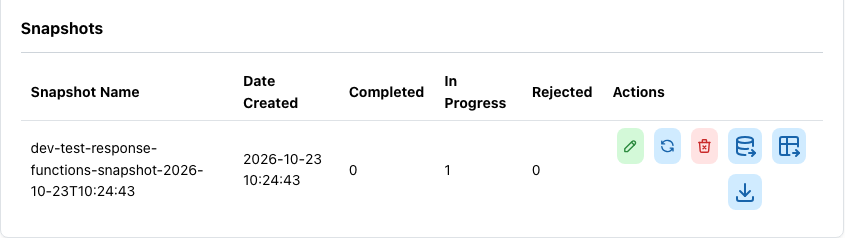

# Data Management

The reVISit analytics platform provides a robust way to manage, backup, and restore your user data.

## Study Visibility

In the study's **Manage** tab, use **Show study on landing page** to control whether the study appears in the public study list. By default, studies are visible. Hide a study when Participants should not be able to browse to other studies or conditions from the landing page.

This setting only hides the study from the landing page. It does not protect the study URL or restrict access to its data. Configure study access and authentication separately if the study should not be public. Re-enable visibility when you want the study to appear in the list again.

## Choose Storage for New Sessions

For a cloud storage study, open the **Datastore** tab and switch **Use local storage for new sessions** on or off. The tab is available when authentication is enabled and a listed administrator is signed in and verified. See [User Management](../data-and-deployment/user-management.md) for authentication setup. This is useful when you need to temporarily stop new sessions from writing to the configured cloud database.

Before changing the switch, check **Configured storage** (the Firebase or Supabase backend set for this deployment) and **Currently used for analytics** (the backend this page is reading). The tab also shows the deployed `VITE_STORAGE_ENGINE` value and either `VITE_FIREBASE_CONFIG` or the Supabase URL and anonymous key. These details are read-only; changing them requires updating the deployment configuration. **Open database** opens the Firebase Firestore data page or Supabase table editor for the configured project in a new tab. If the Supabase URL does not identify a dashboard project, the link is **Open configured endpoint** and opens that URL instead. Access to the provider page depends on your provider account.

Changing the switch reloads the page and affects new sessions only. Participants who are already in progress continue using the storage they started with. While the switch is on, each new Participant's data stays in that Participant's browser and is not uploaded if cloud storage is re-enabled later. Use this setting only when local-only collection is appropriate for your study.

<!-- TODO: Screenshot — Purpose: help administrators identify the new Datastore controls and distinguish the configured backend from the backend used for analytics. Location: study Analysis > Datastore tab in study/dev, signed in as a verified administrator on a synthetic cloud-backed study. Capture state: show Configured storage, Currently used for analytics, Open database (or Open configured endpoint), and Use local storage for new sessions; redact the Firebase config, Supabase URL/key, project IDs, and any real participant information. Framing: crop to the Datastore panel with the switch and labels visible. Annotation: #FFBD59 border and arrow around the switch if it is hard to locate. Alt: Datastore panel showing storage status and the switch for new local sessions. Save to: ./img/data-management/datastore-controls.png. -->

## Snapshots

A **snapshot** in the data management platform is an exact copy of the current state of a particular study dataset. This includes all the data gathered from each participant as well as the current study assignment sequence. To create a snapshot, you can navigate to the "Manage" tab within a particular study's analytics interface and click "Snapshot" in the "Create A Snapshot" section. When a snapshot is created, you will see the name of the snapshot in the "Snapshots" list below. This does not remove the data from the current study dataset.

### Snapshot Participant Status

The Snapshots table lists the most recently created snapshot first and summarizes its participant status at the time of the snapshot:

- **Completed**: Participants who completed the study and were not rejected.
- **In Progress**: Participants who had not completed the study and were not rejected.
- **Rejected**: Participants who were rejected.

New snapshots store these counts when they are created. For an older snapshot, reVISit calculates the counts the first time you view it. The table shows **Loading...** during that calculation or **Unavailable** if the counts cannot be calculated. You can still rename, restore, delete, or download that snapshot while a count is loading or unavailable.

## Archiving Data

When you archive your data, it first creates a snapshot of the current study data. Then, the current study data is completely removed -- allowing you to essentially "reset" the study while creating a backup copy to restore at a later point.

## Restoring a Snapshot

At any point, the current study data can be restored to a snapshot. In your snapshot list, you will see a "restore" icon which will allow you to do this. When you restore a snapshot, a new snapshot of the current study data will first be created. All data from the snapshot being restored is then copied back into the current study data. Your snapshot will _not_ be removed.

## Deleting a Snapshot

A snapshot can be deleted at any time in order to free up space in your Firebase application. Simply click the "delete" icon next to any snapshot and follow the onscreen instructions to remove it.

:::danger
All data deletion is permanent. Once deleted, you will not be able to view or download this data.
:::

## Deleting Live Data

You can delete the live study data at any point. Note that this delete functionality will _not_ create a snapshot of the data first; it will instead completely clear the data for this individual study.

:::danger
All data deletion is permanent. Once deleted, you will not be able to view or download this data.
:::

:::info
Whenever live data is deleted, reVISit will automatically generate a new configuration file for the upcoming participant. Thus, if you go into your Firebase UI after deleting your live data, you will still see the `configs/` folder with one configuration inside.
:::
