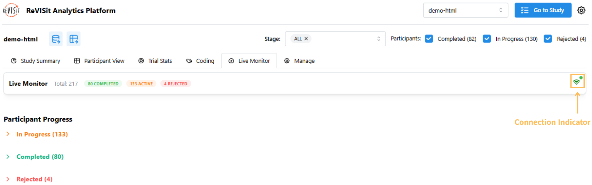
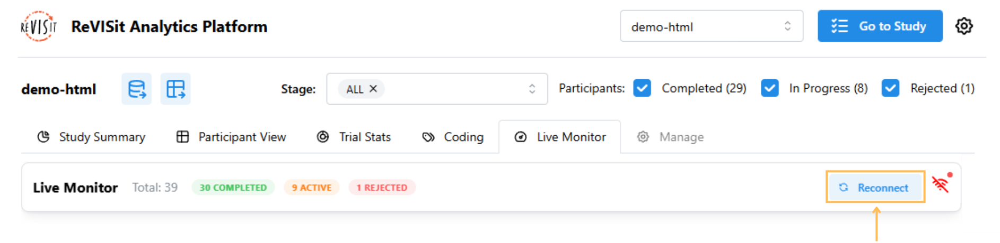
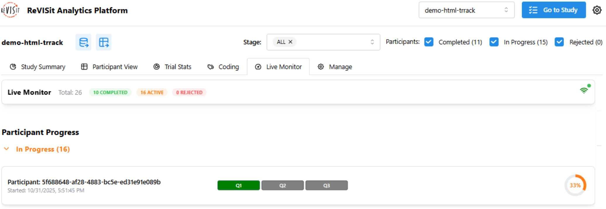
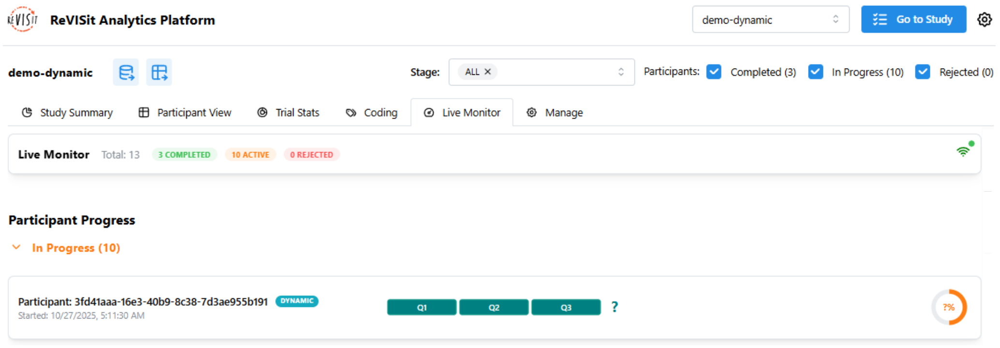

# Live Monitor

The Live Monitor gives you a real-time view of participant progress throughout your study. It automatically updates using Firebase listeners, so you’ll see changes the moment they happen — no need to refresh the page.

Check out the [Live Monitor Demo](https://revisit.dev/study/analysis/stats/demo-dynamic/live-monitor).

:::warning
Live participant monitoring works only with the Firebase storage engine and requires an active internet connection. The **Auto-timeout** setting is also available with Supabase and local storage.
:::

## Real-Time Updates

To get started, open the Live Monitor tab under Analysis and check the connection indicator to see whether you’re connected, reconnecting, or disconnected.
Hovering over the connection icon displays the last time the data was updated.

If your internet connection temporarily drops, the Live Monitor will automatically reconnect once you’re back online. You can also click the Reconnect button to refresh the connection manually.

## Automatically Release Participant Slots

Use **Auto-timeout** to free places held by participants who have not finished within a chosen duration. Only study administrators can change this setting.

1. Open **Live Monitor** under **Analysis** and find the **Auto-timeout** card.
2. Enter a duration in **Auto-timeout minutes**. The initial value is **60 minutes**; the minimum is **1 minute**, in whole minutes. Auto-timeout is disabled by default.
3. Turn on **Enable auto-timeout**, then confirm with **Enable auto-timeout** in the **Enable auto-timeout?** dialog.

While enabled, changes to the duration save when you leave the minutes field. Turn off the switch to stop applying new automatic timeouts.

<!-- TODO: Screenshot — Open Analysis > Live Monitor as an administrator with Auto-timeout enabled at 60 minutes. Frame the Auto-timeout card with its explanation, minutes field, and switch. Highlight the switch with a #FFBD59 border and matching arrow. Alt: Auto-timeout card enabled with a duration of 60 minutes. Save to ./img/live-monitor/auto-timeout.png. -->

The duration is measured from the participant's assignment time, not their last response or activity. During data collection, ReVISit checks unfinished assignments in the current stage and times out those that have reached the duration when a new participant starts or when an administrator opens Live Monitor. If the stage is full when a new participant arrives, ReVISit first releases expired participants so the newcomer can be admitted. Reaching the duration alone does not trigger an update, and leaving Live Monitor open does not run a periodic check; reopen it to refresh timeouts.

:::warning[Self-hosted Supabase]
If your Supabase database was initialized with an older reVISit `revisit.sql`, apply the `utc-created-at.sql` migration described in the [Supabase storage and operations guide](https://github.com/revisit-studies/study/blob/3b5a7526c57cf2e8c17321bad2ac3b12bb002537/supabase/README.md#storage-and-ongoing-operations) before enabling auto-timeout. Without it, a database running outside UTC shifts participant start times and timeout deadlines.
:::

Timed-out participants no longer count toward stage or condition limits. Their data is retained, and they can continue and finish normally. They appear as **Timed Out** until they finish, then as **Completed Late**. A late completion does not occupy a slot again, so the number of people who eventually finish can exceed the recruitment limit. Disabling auto-timeout does not restore slots already released.

:::info[Existing studies]
If enabling auto-timeout reports that the stage contains legacy assignments without saved order information, create and activate a new stage in [Stage Management](./stage-management.md) before enabling it.
:::

### Automatic Timeout and Manual Time Out

The existing manual **Time Out** action in the **In-Progress Participants** review dialog rejects the selected participant and returns their assignment for reuse. Their data is retained, but they are marked **Rejected** and cannot continue normally unless the rejection is undone. Use automatic timeout when you want to release capacity while still allowing a participant to finish. Auto-timed-out participants are excluded from the manual review list.

## Tracking Participant Progress

Participants are grouped as **Completed**, **In Progress**, **Rejected**, **Timed Out**, or **Completed Late**, and you can expand or collapse sections as needed. You can also filter participants by status or stage using the controls at the top. They are sorted by creation time, with the most recent participants appearing first.

For participants still in progress, question blocks show task status: green for completed, gray for unanswered, teal for dynamic study items. Hovering over a question block displays the task name in a tooltip.

If your study uses a [dynamic block](../../typedoc/interfaces/DynamicBlock/), you’ll see a "?" instead of a percentage in the progress indicator. This happens because the total number of tasks in a dynamic study isn’t fixed and can’t be calculated ahead of time.

import StructuredLinks from '@site/src/components/StructuredLinks/StructuredLinks.tsx';

<StructuredLinks
    demoLinks={[
        {name: "HTML Demo", url: "https://revisit.dev/study/analysis/stats/demo-html/live-monitor"},
        {name: "Dynamic Block Demo", url: "https://revisit.dev/study/analysis/stats/demo-dynamic/live-monitor"}
    ]}
/>