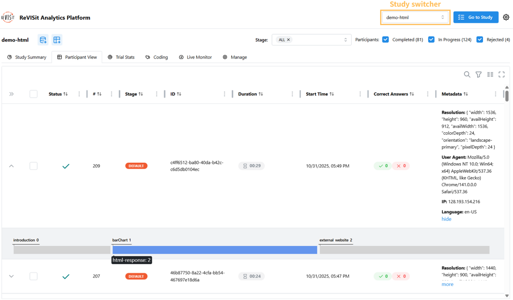

# Participant View

The participant view displays the user data of a study in a table format. It is designed to allow researchers to inspect each record in detail.

Each row represents a record of a participant in the study. It includes the participant's ID, status indicator, stage, metadata (resolution, user agent, IP address, language), time they spent, and count of correct answers.
For each trial, all question IDs and corresponding answers are displayed in the same cell. The time the participant spent on the trial is shown in a separate cell.

The **Status** column distinguishes completed, in-progress, and rejected participants. Participants whose slots were released by [auto-timeout](./live-monitor.md#automatically-release-participant-slots) show **Timed out**. If they subsequently finish, the cell shows **Late**, with the tooltip **Completed late after timing out**. These participants remain separate from ordinary completions.

The analysis status filters include **Completed**, **In Progress**, **Rejected**, **Timed Out**, and **Completed Late**; all five are included by default. Deselect statuses to exclude them from the analysis and downloads. If a participant is rejected after an automatic timeout, their status is **Rejected**.

You can quickly navigate to different studies by using the study switcher in the top right corner.
