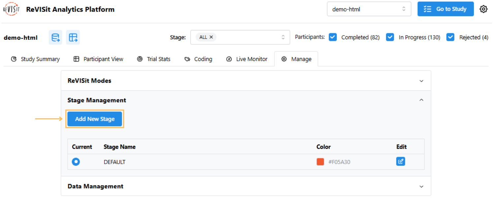
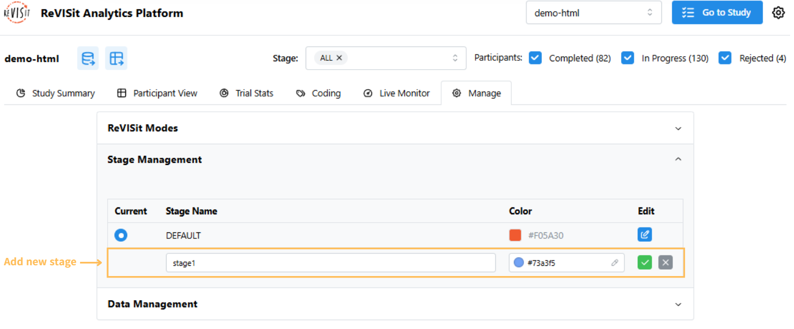
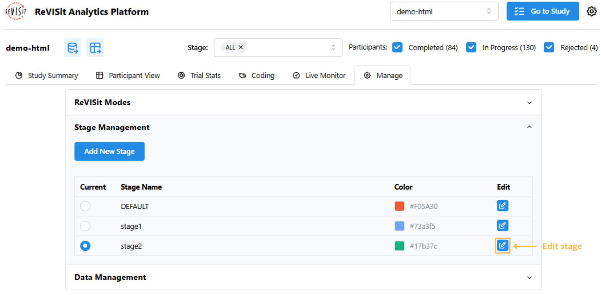
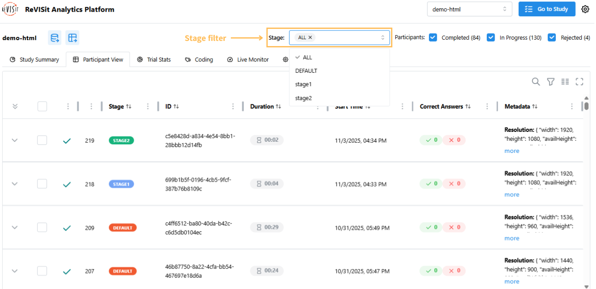

# Stage Management

## Overview

Stage Management helps you organize participants into different parts of your study. It’s useful for studies that have multiple sections or happen over time. Using stages makes it easier to track, filter, and analyze participants based on when they took part in the study, either as a pilot participant or during different phases of data collection.

## Getting Started

Sign in as an administrator, open **Analysis**, and select the **Stage Management** tab.

:::info
All studies start with a **DEFAULT** stage, which cannot be removed. The default color is orange (`#F05A30`), but you can change it if you want.
:::

## Adding a New Stage

1. Click the **Add New Stage** button.

2. Enter a stage name and pick a color. You can type a color code or choose one from the color picker.

3. Click the green check mark to save.

:::warning
Stage names cannot be `DEFAULT`, `ALL`, or `N/A`.
:::

## Setting the Current Stage

The active stage determines where new participants will be added. Click **Inactive** next to the stage you want, then confirm with **Yes, activate stage**. Its status changes to **Active**. Existing participants stay in their original stages.

## Monitoring Participants and Conditions

The stage table shows **Current** (ongoing participants), **Completed**, and **Total / Maximum**. The total includes both ongoing and completed participants. Rejected participants are excluded from these counts.

The **Participant limits for** panel applies to the active stage. If your Study Config declares [between-subject factors](../designing-studies/factors.md#between-subject-factors), the panel also shows a row for each combination of factor levels, with its own **Current**, **Completed**, **Total / Maximum**, and **Enabled** controls. Counts and recruitment settings apply separately to each stage; participants from earlier stages do not count toward the active stage's limits.

## Controlling Recruitment

Use the **Enabled** switch for a condition combination to control whether new participants can receive it. Confirm the change in the **Enable condition?** or **Disable condition?** dialog. Disabling a combination stops future assignments to it without changing existing participants or their data. You can enable it again later.

Once a stage has participant assignments, you can add conditions but cannot remove or rename its existing conditions. Disable recruitment to an existing condition, or create a new stage when you need a different set of conditions.

## Setting Participant Limits

Turn on **Limit participants** to set a maximum for the active stage. Enter **Maximum participants**, then leave the field to save it. Without a limit, the stage table shows **Unlimited**.

For studies with between-subject factors, **Assign participants** lets you choose how to divide that maximum:

- **Evenly** divides the maximum across enabled condition combinations. If it cannot be divided equally, some combinations receive one extra place. For example, a maximum of 10 across three enabled combinations gives targets of 4, 3, and 3.
- **Manually** lets you edit each condition's maximum in **Total / Maximum**. Leave each field to save it. The stage's **Maximum participants** follows the sum of the condition maximums, so edit the condition fields to change that total.

Both ongoing and completed participants use places. New assignments stop when the stage maximum or the eligible conditions' targets are reached. Disabling a condition in manual mode preserves its target; it does not automatically give those places to another condition.

:::info
You cannot save a new stage maximum or manual condition target below the number of participants already assigned, excluding rejected participants. Setting it equal to the current total is allowed and leaves no places for new participants at that limit. For example, a condition with 6 completed and 2 ongoing participants needs a manual target of at least 8.
:::

## Timing Out Ongoing Participants

To review participants who have not finished, click a nonzero **Current** count in the stage table or a condition row. The **In-Progress Participants** dialog lists participants for that stage or condition, with their participant number, ID, and elapsed time. If the assignment's start time is unavailable, it shows **Length unavailable**.

Click **Time Out** beside a participant to reject them with the reason **Timed out by admin**. Their collected data is retained, their sequence assignment becomes available for reuse, and they no longer count toward stage or condition capacity. This frees a place for a replacement when the recruitment settings allow one.

:::warning
**Time Out** is a manual action; elapsed time alone does not expire a session. A participant who is still working discovers the rejection on their next save. Review the participant before freeing their place.
:::

## When Admission Is Closed

New participants see a **Study full** page when they cannot be admitted. If the stage maximum has been reached, the message is “Sorry, no more participants can join the [stage name] stage at this time.” If all conditions are disabled, or only disabled conditions have capacity, the message is “Sorry, this study is full and cannot accept more participants at this time.”

To reopen recruitment, activate a stage with available places, increase the relevant limits, enable a condition with capacity, or time out an abandoned ongoing participant.

## Changing Stage Colors

Each stage has a color to help you identify it in the analysis views. To change a stage color:

1. Click the edit icon.

2. Pick a new color or enter a color code.

3. Click the green check mark to save.

:::warning
Stage names cannot be changed after you create them, but you can always change the color.
:::

## Stage Filter in Participant View

Each participant’s stage is shown in the table, making it easy to see and group participants. You can filter by stage using the filter at the top and select one or more stages.

