# Configuring Firebase

<a href="https://firebase.google.com/" target="_blank" >Firebase</a> is an app development platform that has extremely useful tools such as storage and real-time synchronization. With Firebase alone, a study creator can capture all data from participants and then export that data for further analysis. In what follows, there are two main products we will be using: the Firestore database and Firebase's storage product.

## Create a Firebase Project

Navigate to <a href="https://firebase.google.com/" target="_blank">Firebase</a> and go to your console.
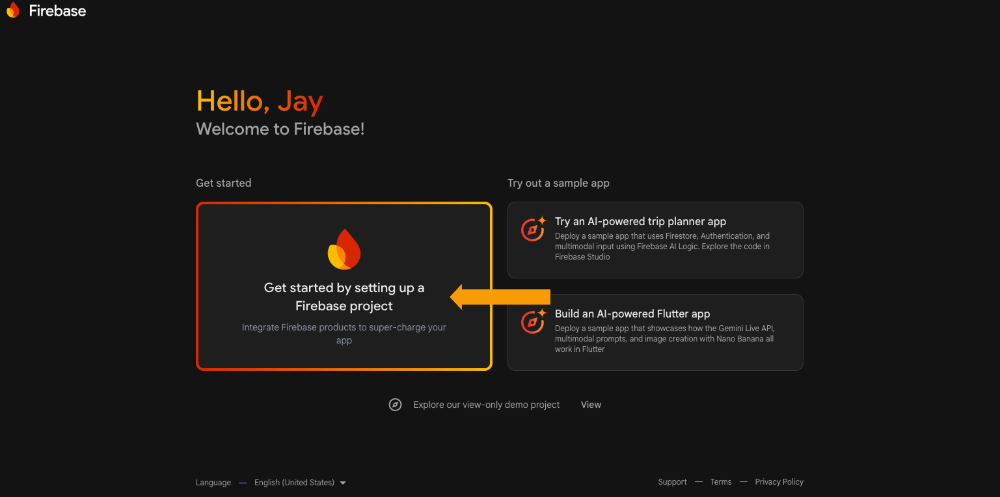

Create a new Firebase project

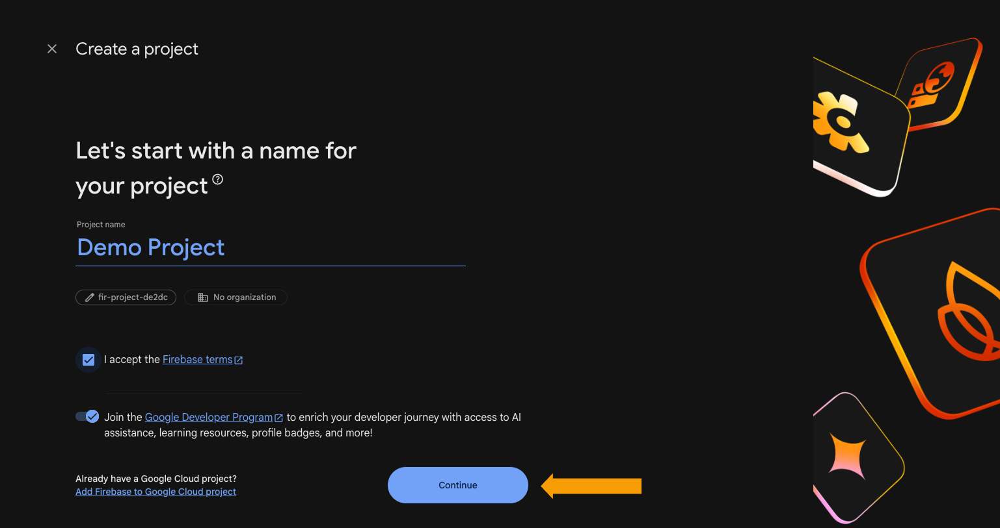
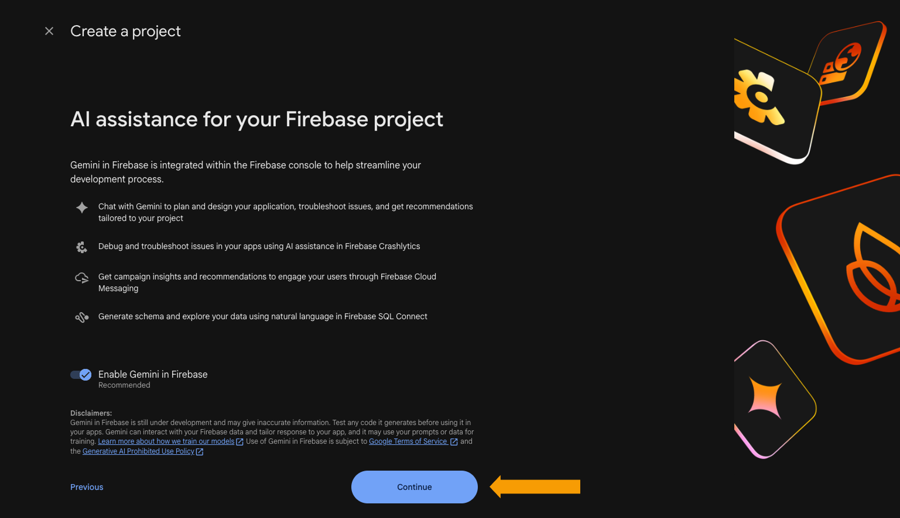

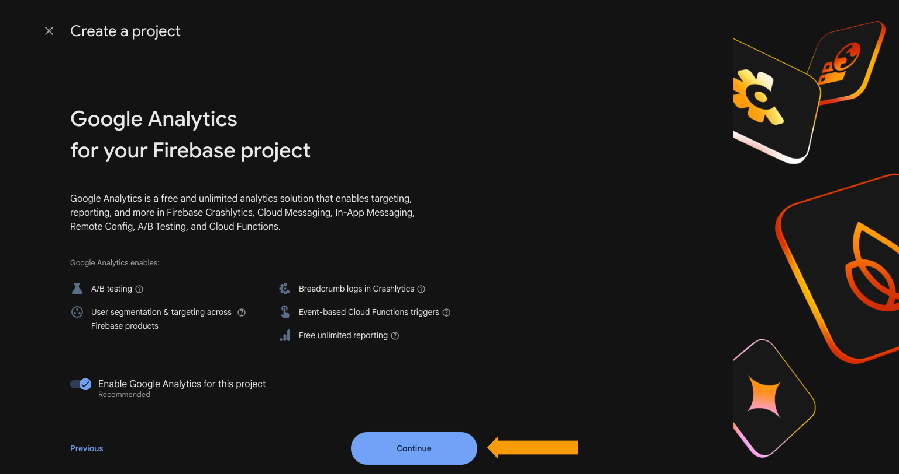

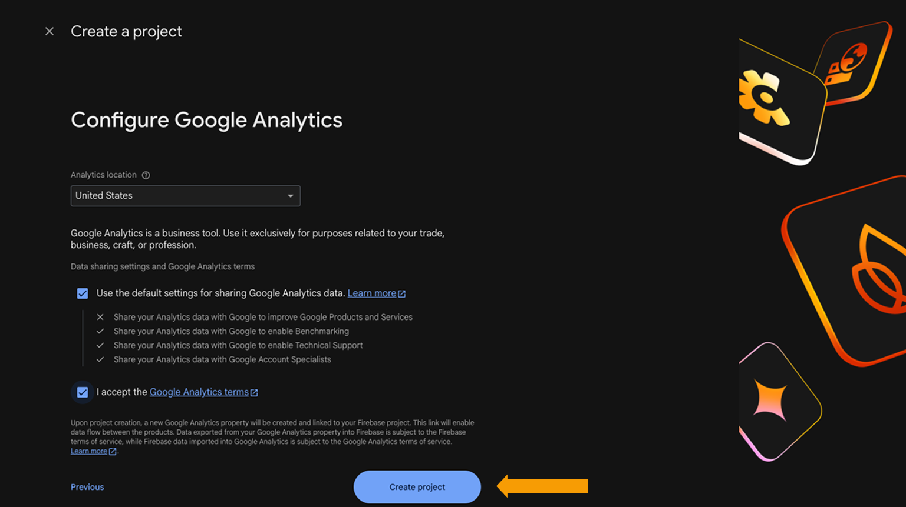

:::note
Enabling Gemini or Google Analytics is not necessary. Feel free to disable this when prompted.
:::

Name your project accordingly.


## Adding a Firestore Database

With your project created, we are now going to add a Firestore database to it. On the left-hand side, you should see a "Databases & Storage" dropdown menu. From that, select "Firestore".

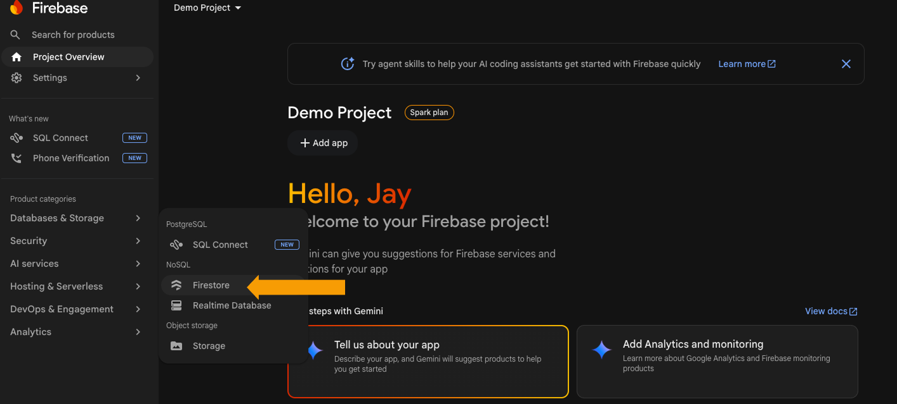

Click "Create Database" in the center of the screen.

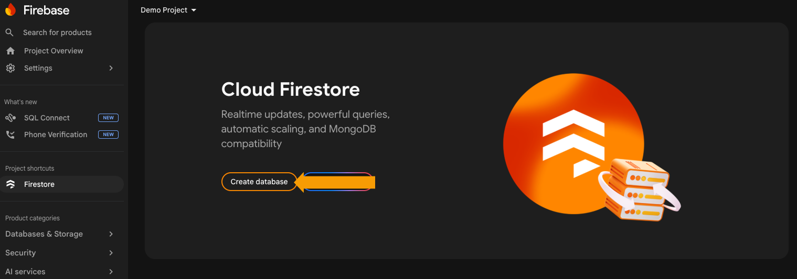

For the next two steps, there is no need to change the defaults. Simply click "Next" and then "Create".

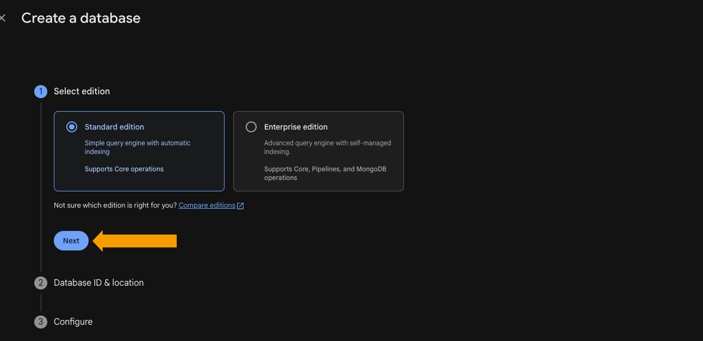

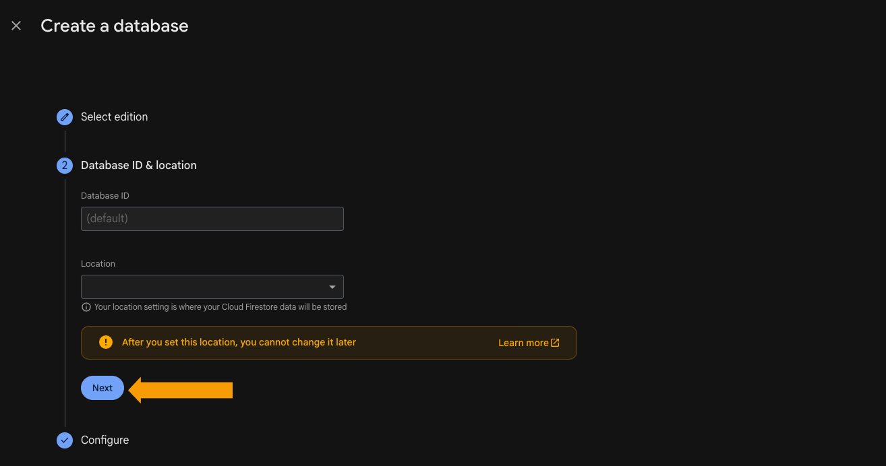

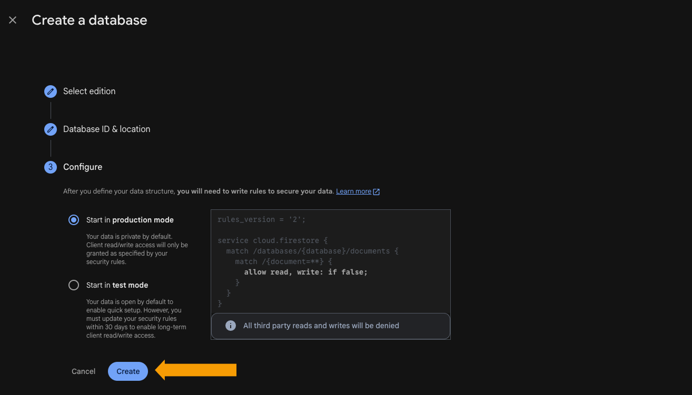

With the new database created, we'll want to change the read/write rules to only allow authenticated users to write to the database. Go to the "Rules" tab (second tab) and copy and paste the following code. Then click "Publish".

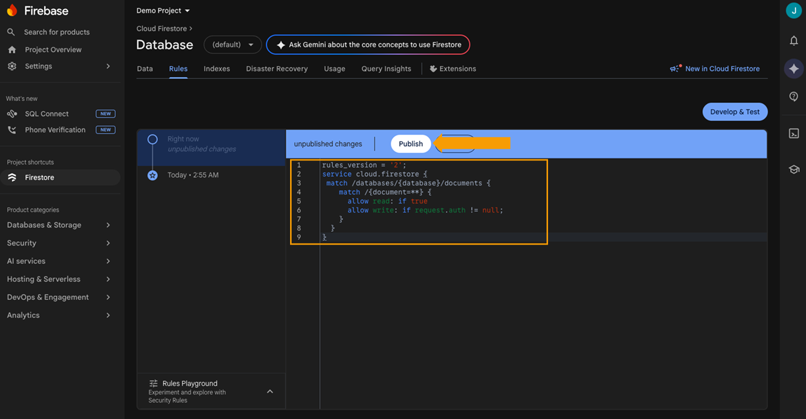

```
rules_version = '2';
service cloud.firestore {
 match /databases/{database}/documents {
    match /{document=**} {
    	allow read: if true;
      allow write: if request.auth != null;
    }
  }
}
```

### Create indexes for participant sequence assignment

Before the first Participant starts, open the Firestore **Indexes** tab and create these two **composite indexes**. Use **Collection** scope and enter `sequenceAssignment` as the collection ID for both:

| Index | Fields in order |
| --- | --- |
| Rejected assignments by time | `rejected` Ascending, `timestamp` Ascending |
| Reusable assignments by time | `claimed` Ascending, `rejected` Ascending, `timestamp` Ascending |

Wait until both indexes are enabled before opening the study. Add them to existing Firebase deployments when upgrading as well. These indexes are created once per Firebase project/database, not once per study.

If an index is missing, ReVISit blocks study startup. In development mode, its error includes a Firebase link that opens the index creation form with the required fields filled in. Follow that link as the Study Designer who administers the Firebase project, then wait for Firebase to finish building the index. You can also create both indexes in the console ahead of time using the table above.

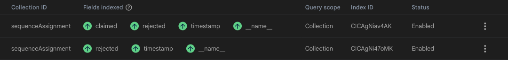

## Adding Firebase Storage

Once that is finished, we will enable standard Firebase storage. Click the "Databases & Storage" dropdown menu again and navigate to "Storage".

:::warning
Cloud Storage for Firebase requires the pay-as-you-go **Blaze** plan; Spark-plan projects cannot access Storage (since February 3, 2026, existing Spark projects also lose Storage access until upgraded). See [Firebase's billing requirements](https://firebase.google.com/docs/storage/faqs-storage-changes-announced-sept-2024). On Blaze, default buckets in eligible no-cost regions (`us-central1`, `us-east1`, or `us-west1`) still include [Always Free limits](https://cloud.google.com/storage/pricing#cloud-storage-always-free). We have run several reVISit studies within those limits (such as [this study](https://vdl.sci.utah.edu/publications/2024_preprint_guardrails/)), but set up billing alerts to avoid unexpected charges.
:::

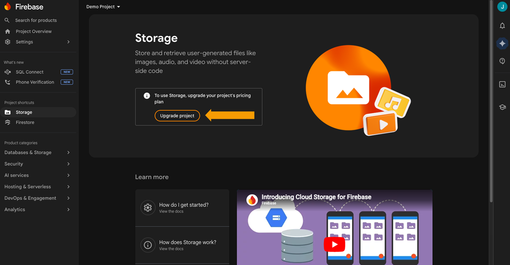

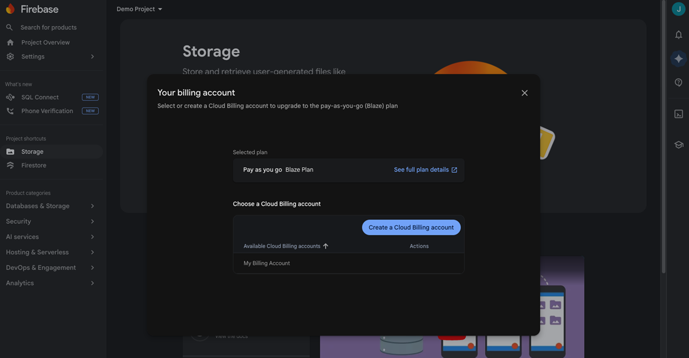

Upgrade to the Blaze plan, then leave the default bucket options selected.

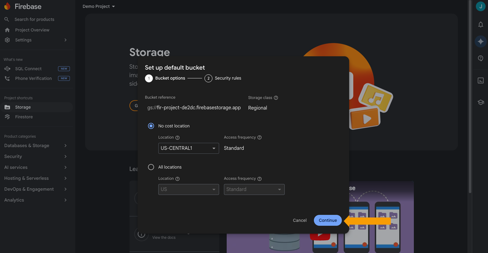

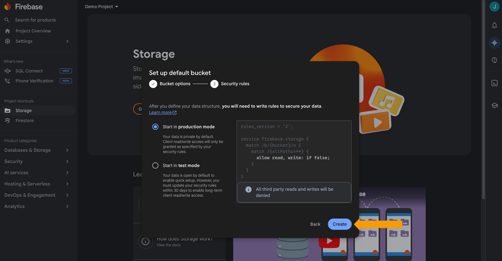

Once the storage product is enabled, navigate to the "Rules" tab. 

Replace the existing rule with the following code (matching the Firestore rule above) and click "Publish":

```
rules_version = '2';

service firebase.storage {
  match /b/{bucket}/o {
    match /{allPaths=**} {
      allow read: if true;
      allow write: if request.auth != null;
    }
  }
}
```

:::warning
These rules allow public reads and writes from any authenticated session (including anonymous Participant sessions), which ReVISit's browser-based flow requires. They do not provide per-participant isolation or admin-only writes at the Firebase layer. Enable [App Check enforcement](#verify-the-deployed-setup) for Firestore and Storage, enable [ReVISit Authentication](./enabling-authentication.md) for analysis pages, and avoid storing directly identifying personal data in unencrypted study records.
:::

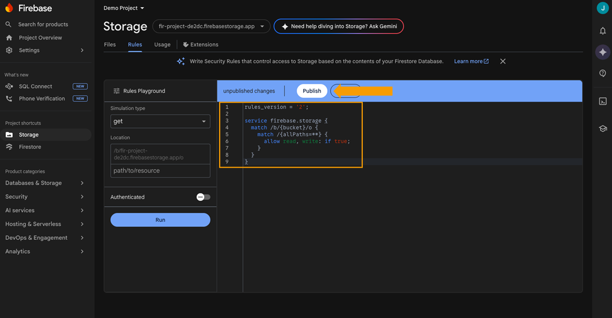

<!-- TODO: Screenshot — Show the Firebase Storage Rules tab with allow read: if true; and allow write: if request.auth != null; entered and the Publish button highlighted with a #FFBD59 border and arrow. Alt: Firebase Storage Rules tab with read and authenticated write rules entered. Replace ./img/enabling-authentication/step17.png. -->

## Adding automatic transcription for Think Aloud studies

If you plan to use [Think Aloud](../../designing-studies/think-aloud.md) studies with Firebase and want transcripts, install the [Google Cloud Speech-to-Text extension](https://extensions.dev/extensions/googlecloud/speech-to-text) from the Firebase Extensions marketplace.

Once the extension is configured for your project, it will automatically transcribe uploaded audio files. This is the setup reVISit expects when you want transcripts to appear in analysis and export workflows.

:::warning
The Speech-to-Text extension requires the **Blaze** plan and uses billable Google Cloud services. In addition, **Firebase Extensions is being sunset on March 31, 2027**: existing instances will continue running, but can no longer be managed through Firebase afterward. See the [Firebase Extensions FAQ](https://firebase.google.com/docs/extensions/faq-and-troubleshooting).
:::

## Adding an App to the Firebase Project

We are now going to add an app to your Firebase project:

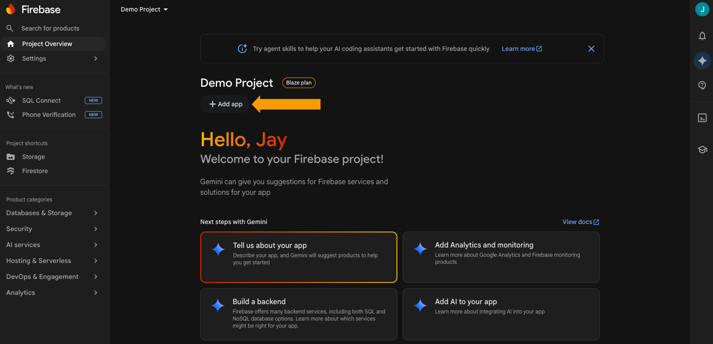

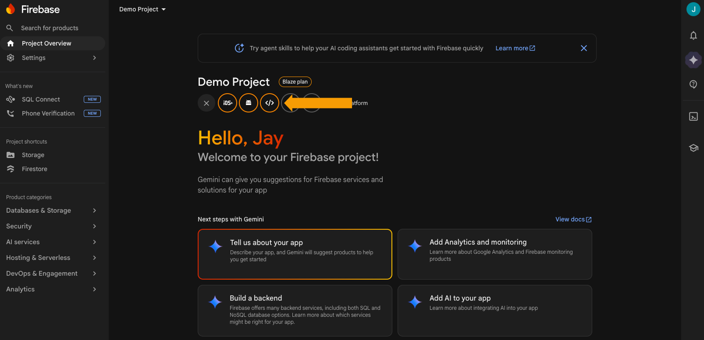

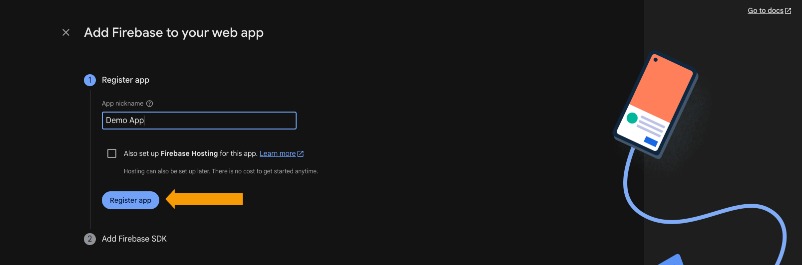

With the app set up, we are ready to copy over the app configuration to your reVISit project. 
In the image below you will see a JSON object denoted as `const firebaseConfig = { ... }`.

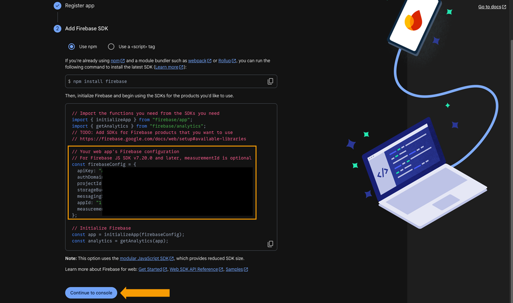

Copy the contents of that JSON object into the `.env` file for the variable `VITE_FIREBASE_CONFIG`. In the `.env` file, your `VITE_FIREBASE_CONFIG` variable should still be a JSON object that is escaped in single quotes.

### Authentication

We are now going to set up the authentication so that your browser is authorized to communicate with your Firebase database.

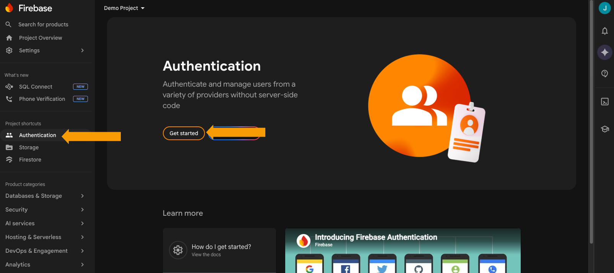

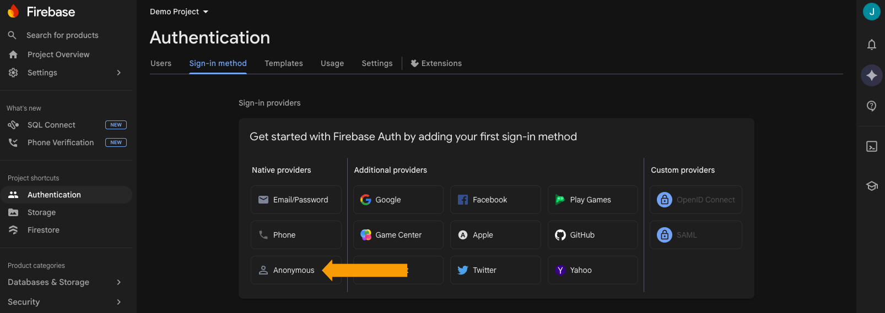

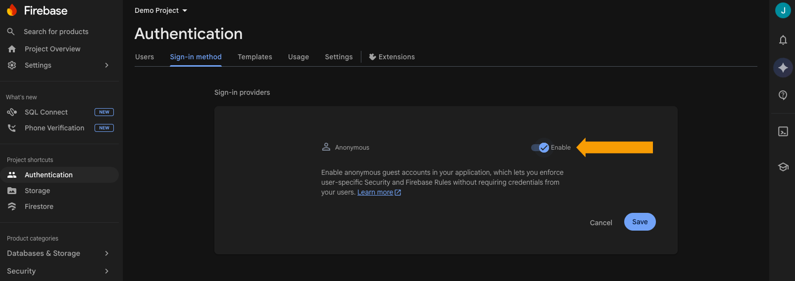

:::info
In addition to what is shown above, you will want to enable "Google Authentication" in the same section of Firebase. You can do this by choosing the "Google" sign in method under the "Additional Providers" section. The anonymous sign-in is used for participants taking the study. It allows them to access and send data to the Firestore without external authentication. The Google sign-in method is used to authenticate administrators for managing studies and data. Please see [here](../enabling-authentication) for more detailed authentication information and set up instructions.
:::

### App Check

App Check verifies that requests to Firebase come from your app. For a new setup, use **Fraud Defense**, which includes **reCAPTCHA Enterprise**. Depending on the console, the provider may appear under either name. Firebase Authentication and App Check are separate: keep the sign-in providers configured above.

:::note[Version compatibility]

These instructions require a reVISit version that supports `VITE_RECAPTCHA_ENTERPRISE_SITE_KEY`. Older versions use the v3 provider. Update reVISit before configuring an Enterprise key; replacing the value of `VITE_RECAPTCHAV3TOKEN` alone does not switch providers.

:::

#### Create an Enterprise site key

1. Open [Fraud Defense in Google Cloud](https://console.cloud.google.com/security/recaptcha) and select the **same project** as your Firebase app. Enable the reCAPTCHA Enterprise API if prompted.
2. Select **Create key**, give it a recognizable display name, and choose **Web** as the application type.
3. Add the hostnames where your study will run. For GitHub Pages, use `your-github-name.github.io`. For a custom domain such as `https://revisit.dev/study/`, use `revisit.dev`. Enter hostnames without `https://`, ports, or paths, and keep domain verification enabled.
   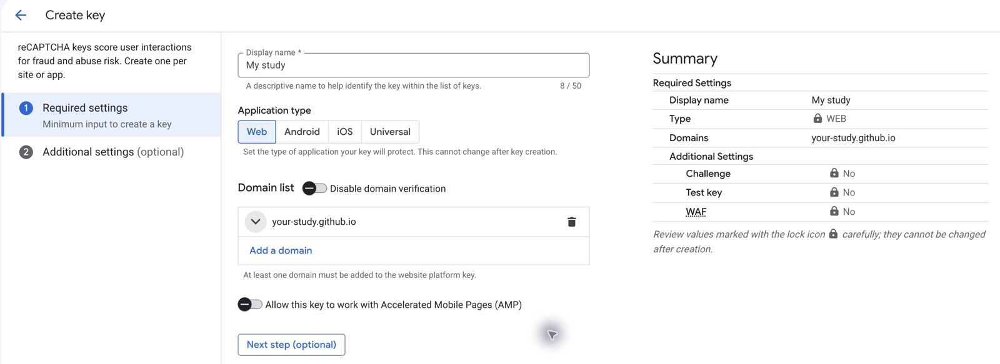

4. Leave **Will you use challenges?** disabled to create a score-based key. Leave the test-key and Web Application Firewall options disabled, then create the key.
   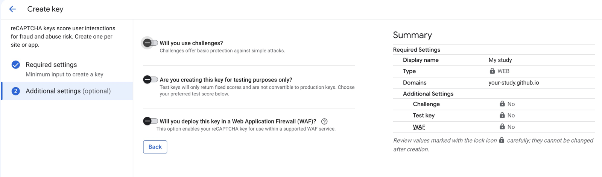

5. Copy the **site key**. You will use the same value in Firebase and your reVISit build. The site key is public; this setup does not require a secret key in your application.

The screenshots use example values. Replace them with your own study name and hostname.

Do not add `localhost` or `127.0.0.1` to the production key. Use the [debug-token setup below](#local-development-with-debug-tokens) for local development.

#### Register the key with your Firebase app

In **Firebase Console → Security → App Check → Apps**, select the Web app whose app ID matches `VITE_FIREBASE_CONFIG`. Choose **Fraud Defense (formerly known as reCAPTCHA Enterprise)**, paste the site key, and save. The default one-hour token lifetime and risk threshold of 0.5 are reasonable starting points.

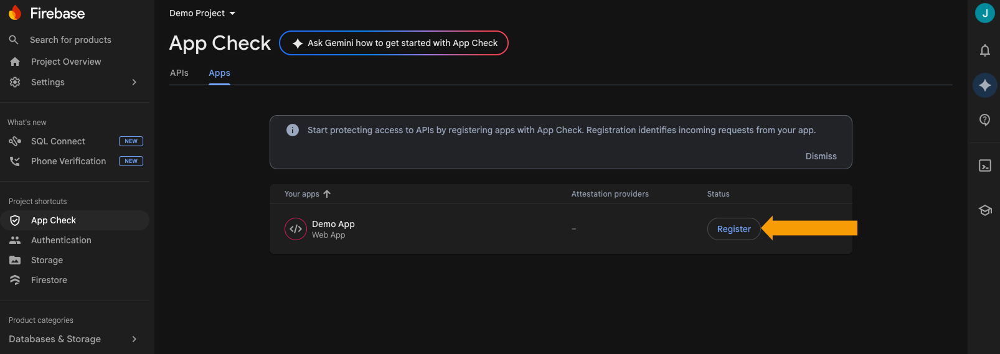

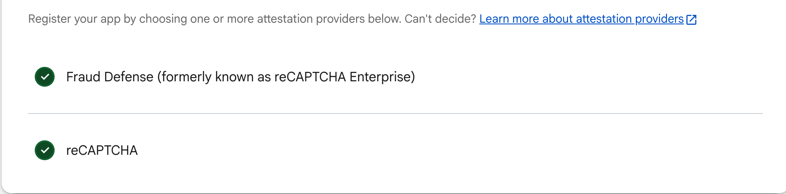

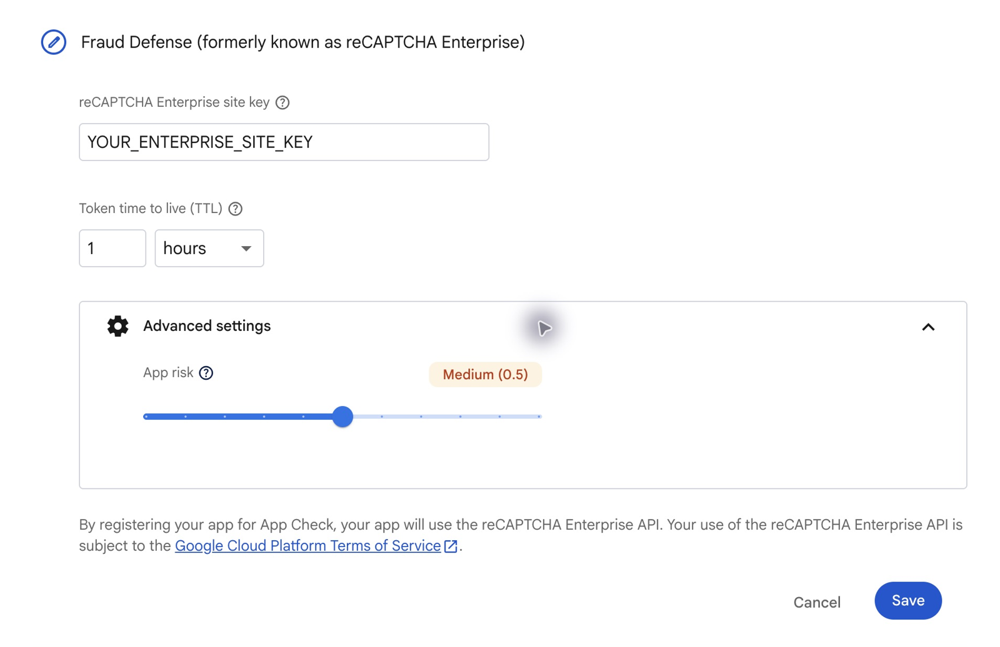

The site key shown above is a placeholder; paste the key you created in Google Cloud.

If you already have a Web app, reuse it. You do not need another app for Enterprise. Its nickname is only a display name: renaming it in **Project settings → General → Your apps** does not change the app ID or require a new `VITE_FIREBASE_CONFIG` value.

#### Configure and deploy reVISit

Set these values in your study repository's `.env`, keeping the `VITE_FIREBASE_CONFIG` value you copied earlier:

```env title=".env"
VITE_STORAGE_ENGINE="firebase"
VITE_RECAPTCHA_ENTERPRISE_SITE_KEY="your-enterprise-site-key"
```

A nonempty `VITE_RECAPTCHA_ENTERPRISE_SITE_KEY` selects Enterprise. When it is empty or unset, reVISit keeps the v3 provider and its existing `VITE_RECAPTCHAV3TOKEN` site key. reVISit enables automatic App Check token refresh for both providers; you do not need to add a refresh timer or load a reCAPTCHA script yourself.

The supplied **Deploy To GitHub Pages** workflow reads the Enterprise site key from `.env`. It does not require a GitHub repository variable for App Check. If you fork the study repository, replace its checked-in key with one configured for your own domain. For other hosting services, supply `VITE_RECAPTCHA_ENTERPRISE_SITE_KEY` in the build environment or `.env`.

These settings are read when the website is built. Restart `yarn serve` after changing local settings; for a hosted site, rebuild and redeploy using the [deployment guide](../deploying-to-static-website.md). Editing `.env` alone does not update an already-published site.

#### Verify the deployed setup

Open your deployed site in a fresh browser session. In the browser's developer tools, check that the App Check request named `exchangeRecaptchaEnterpriseToken` succeeds. Then use an example study to check that responses save and data uploads succeed. Check Firebase's App Check request metrics and verify that the token refreshes during an open session; with the default one-hour lifetime, refresh is expected at approximately 30 minutes.

A page loading or an upload succeeding does not by itself prove App Check is working: services in **Monitoring** mode still accept requests without valid App Check tokens. Monitor verified requests in **Firebase Console → Security → App Check → APIs** for both **Cloud Firestore** and **Cloud Storage**, confirm all deployed apps are registered, and then click **Enforce** on each service (propagation can take up to 15 minutes). See Firebase's [Enterprise App Check guide](https://firebase.google.com/docs/app-check/web/recaptcha-enterprise-provider) and [enforcement guide](https://firebase.google.com/docs/app-check/enable-enforcement).

#### Migrate an existing v3 deployment

Keep your existing v3 key and registration while adding Fraud Defense to the **same Firebase Web app**. Both providers can remain registered at the same time. New and existing sessions built with v3 can continue using v3 while a newer deployment uses Enterprise.

1. Create and register the Enterprise key as described above, without removing v3 or changing enforcement settings.
2. Set `VITE_RECAPTCHA_ENTERPRISE_SITE_KEY` in `.env` on your development branch and deploy a preview or `dev` first. The existing `main` branch keeps using v3 until you release the change. Previews and development builds may share the production database, so use an example study rather than an active study collecting Participant data.
3. Verify token exchange, response saving, uploads, and refresh before merging the development branch into `main`. The release carries the `.env` setting into production, so new clients will then use Enterprise.
4. Preserve both registrations for older deployments and open browser sessions. To return new clients to v3, clear the Enterprise setting used by that build and rebuild/redeploy. Leave the legacy v3 key configured for this rollback, and keep Enterprise registered for sessions already using it.

Google's [migration of Classic keys to Google Cloud](https://docs.cloud.google.com/recaptcha/docs/migration-overview) is separate from switching the Firebase provider. It does not, by itself, require changing your reVISit client.

#### Local development with debug tokens

When you run `yarn serve`, reVISit enables Firebase App Check debug mode for local development. The debug provider lets you test locally without adding local domains to the production key.

1. Set `VITE_STORAGE_ENGINE="firebase"` and your Firebase configuration in `.env`, then start or restart `yarn serve`.
2. Open `http://localhost:8080`, select a demo study, and open your browser's developer console.
3. Copy the App Check debug token printed in the console.

   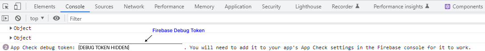

4. In **Firebase Console → App Check → Apps**, open your Web app's menu, select **Manage debug tokens**, and register the token.

   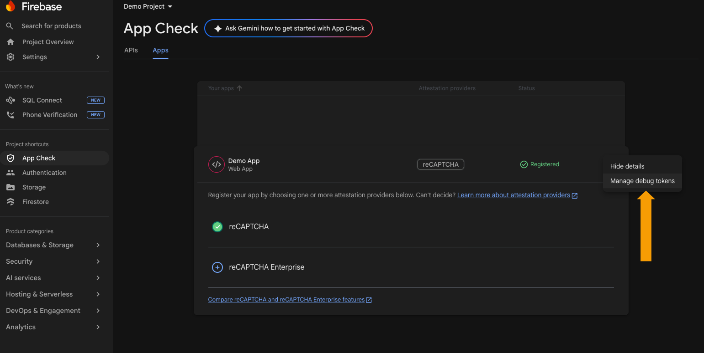

   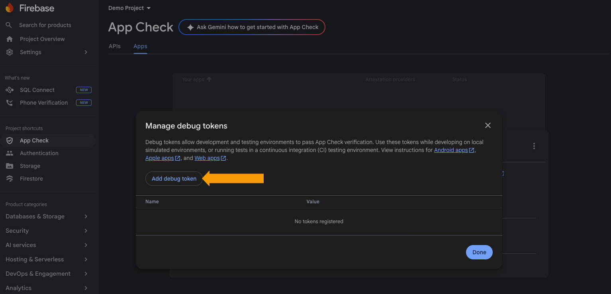

   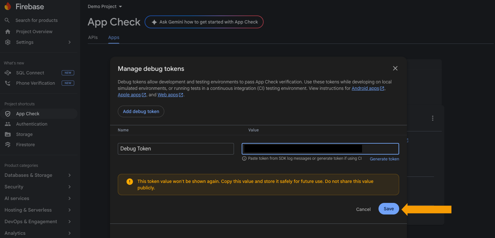

5. Reload the local site. If browser storage is cleared and a new debug token is generated, register the new token too.

Keep debug tokens private and out of source control. Debug mode does not verify real Enterprise attestation; test that separately on your deployed site. See [Firebase's debug-provider guide](https://firebase.google.com/docs/app-check/web/debug-provider).

## Allowing for CORS requests

Once that is finished, configure a CORS policy on your Storage bucket using the [Google Cloud CLI](https://cloud.google.com/sdk/docs/install) (`gcloud storage`, replacing deprecated `gsutil`, which will be removed from the Google Cloud CLI package after March 2027 — see [Cloud Storage CLI guidance](https://cloud.google.com/storage/docs/gsutil)).

Create a file named `cors.json` with the following contents:

```json title="cors.json"
[
  {
    "origin": ["*"],
    "method": ["GET"],
    "maxAgeSeconds": 3600
  }
]
```

Then apply the policy to your bucket:

```bash
gcloud storage buckets update gs://<your-cloud-storage-bucket> --cors-file=cors.json
```

You can find the link for the storage bucket by navigating to the "Storage" product in Firebase.

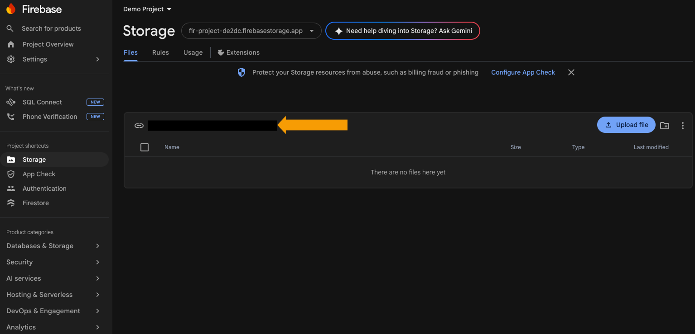

Assuming that you have already changed the `VITE_STORAGE_ENGINE` variable in the `.env` file to "firebase", you can now call `yarn serve` to launch the server and navigate to http://localhost:8080 to launch any demo study. All data from any participant session will automatically be uploaded to Firebase.

:::note
The build must also use `VITE_STORAGE_ENGINE="firebase"`. A deployment workflow can override your local `.env` settings, so check its build environment before publishing.
:::


## Deployment

If you are intending to deploy your reVISit application to a static website, we suggest following our [guide to deploy to GitHub Pages](../deploying-to-static-website.md). In this, you'll see that there is an additional step that you will need to follow in Firebase so that your custom domain can authorize users.

import StructuredLinks from '@site/src/components/StructuredLinks/StructuredLinks.tsx';

<StructuredLinks
    referenceLinks={[
        {name: "Firebase", url: "https://firebase.google.com/"},
        {name: "Firebase Tier Limits", url: "https://cloud.google.com/storage/pricing#cloud-storage-always-free"},
        {name: "Firebase Enterprise App Check", url: "https://firebase.google.com/docs/app-check/web/recaptcha-enterprise-provider"},
        {name: "Google Cloud Fraud Defense", url: "https://console.cloud.google.com/security/recaptcha"},
        {name: "Deploying to GitHub", url: "../../deploying-to-static-website"}
    ]}
/>
