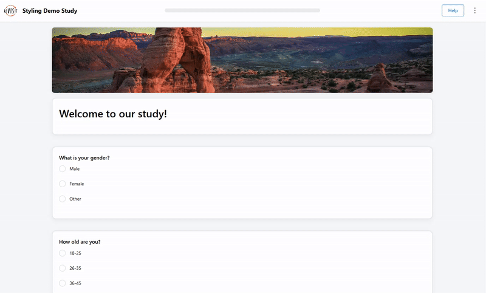
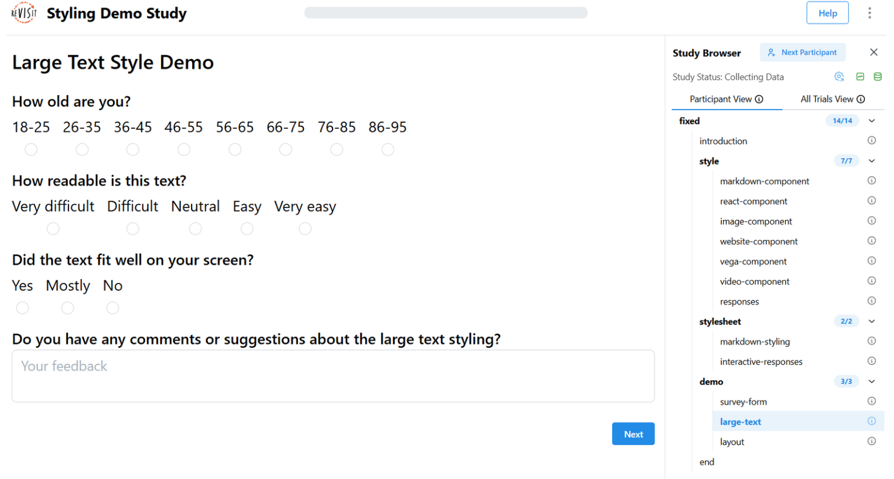
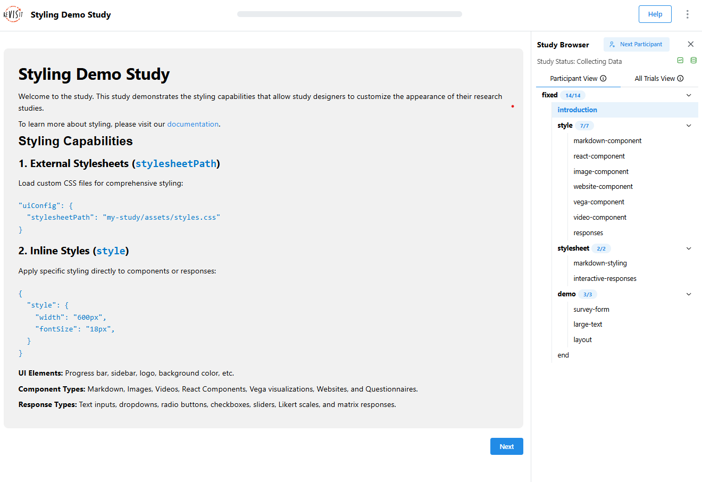
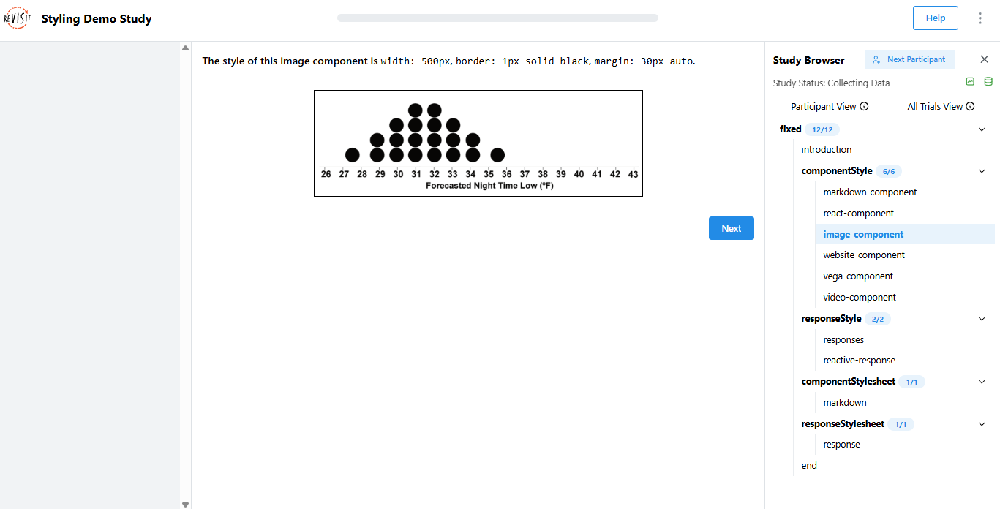
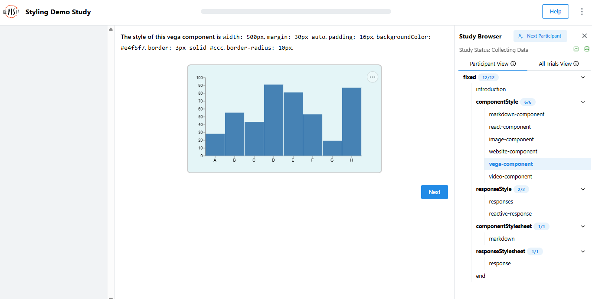
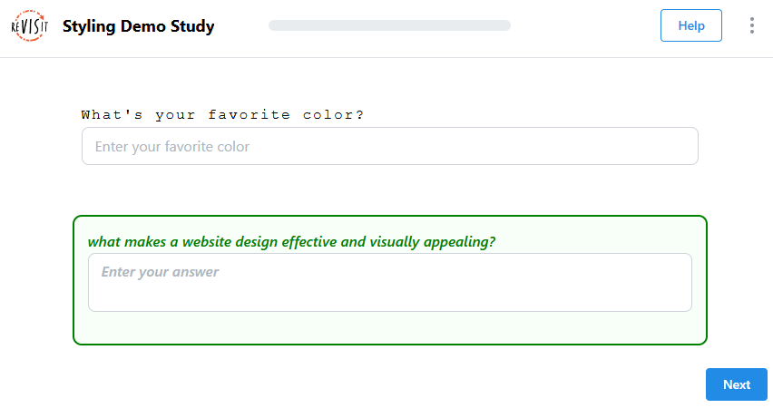
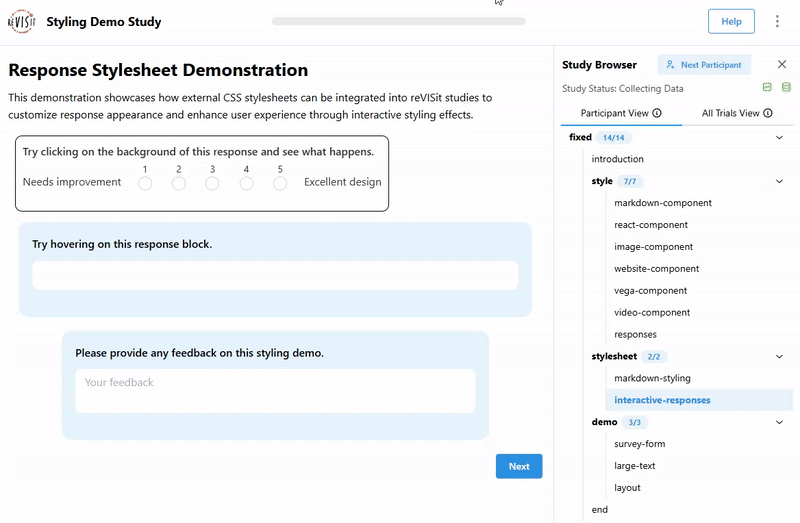

# Applying Styles

ReVISit provides flexible styling capabilities to customize the appearance of your study components and responses. You can apply styles at three levels: **globally through UI configuration**, at the **component** level, and at the **response** level.

This comprehensive styling feature allows you to create accessible and visually appealing study interfaces that enhance the participant experience.

## Choosing a Color Mode

Set `uiConfig.colorMode` to choose the color theme for participants. The default is `"light"`. Set it to `"dark"` to use the dark theme, or to `"userPreference"` to follow the participant's system color preference.

```json title="public/study-name/config.json"
{
  "uiConfig": {
    "colorMode": "userPreference"
  }
}
```

For a `website` component, set `colorMode` to `"light"` or `"dark"` to set the embedded iframe's CSS color scheme. If omitted, the iframe inherits the study's current mode. This does not change the surrounding ReVISit interface. The embedded page must support CSS color schemes to respond; an external website may ignore this setting.

## Styling Methods

There are two primary ways to apply styles to your study:

### 1. External CSS Files (`stylesheetPath`)
For comprehensive styling with complex rules, pseudo-classes, etc. across all components, you can load external CSS files.

```json title="public/study-name/config.json"
"uiConfig": {
  "stylesheetPath": "study-name/assets/style.css"
}
```

When styling elements with external CSS files, target them using the appropriate selectors:

**Class Selectors:**
- Sidebar: `.sidebar`
- Study Browser: `.studyBrowser`
- Header/Title Bar: `.header`
- Main Content Area: `.main`
- Logo Image: `.logoImage`
- Study Title: `.studyTitle`
- Progress Bar: `.progressBar`
- Help Modal: `.helpModal`
- Component Container: `.componentType` (e.g., `.markdown`, `.image`)
- Response type: `.responseType` (e.g., `.textOnly`, `.likert`)
- Response Block Container: `.responseBlock`
- Response Block Container with Location: `.responseBlock-location` (e.g., `responseBlock-aboveStimulus`, `responseBlock-belowStimulus`)
- Individual Response: `.response`
- Required marker in a question prompt: `.required-asterisk`

**ID Selectors:**
- Component: `#componentName` (e.g., `#introduction`, `#survey-question`)
- Response: `#responseId` (e.g., `#final-feedback`, `#user-rating`)

:::info
Styles are applied in the following order (later styles override earlier ones):

1. **Global UI Styles** (`uiConfig.stylesheetPath`)
2. **Component Styles** (`component.stylesheetPath` and `component.style`)
3. **Response Styles** (`response.stylesheetPath` and `response.style`)
:::

You can style the required marker that appears in a response prompt using `.required-asterisk`:

```css title="public/study-name/assets/style.css"
.required-asterisk {
  color: #c00;
  margin-right: 0.25em;
}
```

### 2. Inline Styles (`style`)
For basic styling like sizing, colors, and fonts, apply specific CSS properties directly to components or responses:

```json title="public/study-name/config.json"
"component": {
    "style": {
        "width": "800px",
        "margin": "20px auto",
        "padding": "30px",
        "backgroundColor": "#96dcf5",
        "border": "1px solid #aeaeae",
        "borderRadius": "12px"
    }
},
```

### Default form layout and response widths

ReVISit centers the stimulus and the response blocks above or below it in a content area up to 880 pixels wide. Those response blocks add responsive horizontal padding, from 16 to 40 pixels, so questions have room on narrow and wide screens.

Answer fields also have default maximum widths based on their response type:

| Default maximum answer width | Responses |
| --- | --- |
| 150 px | `numerical`, `date`, and `shortText` with `builtInValidation` set to `phoneNumber` or `usPhoneNumber` |
| 180 px | `time` |
| 280 px | Other `shortText` responses and `dropdown` responses, including multi-select dropdowns |
| Available width | Other response types, such as `longText`, `radio`, `checkbox`, `matrix`, `slider`, and ranking responses; the response itself has a 1600 px maximum |

These defaults keep short answers compact while leaving longer answers and choice groups room to use the form area. To choose a different width for one response, set CSS width properties in its `style` object. When `style.width`, `style.minWidth`, or `style.maxWidth` is set, ReVISit does not apply the response-type default cap.

```json title="public/study-name/config.json"
{
  "id": "feedback",
  "prompt": "What would you change about the study?",
  "type": "shortText",
  "style": {
    "width": "100%",
    "maxWidth": "500px"
  }
}
```

## UIConfig Styling

### Using External CSS Files

Apply global styles that affect the entire study interface:

```json title="public/study-name/config.json"
"uiConfig": {
  "contactEmail": "your@email.com",
  "logoPath": "study-name/assets/logo.svg",
  "withProgressBar": true,
  "withSidebar": true,
  "stylesheetPath": "study-name/assets/globalStyle.css"
}
```

### Examples

#### Shared form style on a component

The `survey-form` component in `demo-style` uses the shared `revisitAssets/googleForm.css` stylesheet. Add the same `stylesheetPath` to another component to reuse it without copying the file. This is a component-level setting; use `uiConfig.stylesheetPath` only when you want a stylesheet across the study.



```json title="public/demo-style/config.json"
"components": {
  "survey-form": {
    "type": "image",
    "path": "demo-style/assets/utah.jpg",
    "stylesheetPath": "revisitAssets/googleForm.css",
    "response": []
  }
}
```

```css title="public/revisitAssets/googleForm.css (excerpt)"
.responseBlock {
  display: flex;
  flex-direction: column;
}

.response {
  background-color: var(--mantine-color-default);
  color: var(--mantine-color-text);
  max-width: 640px;
  margin: 10px auto 0;
  padding: 20px;
  border: 2px solid var(--mantine-color-default-border);
  border-radius: 12px;
}
```

#### Large Text



The `large-text` questionnaire applies this stylesheet to one component:

```json title="public/demo-style/config.json"
"components": {
  "large-text": {
    "type": "questionnaire",
    "stylesheetPath": "demo-style/assets/style/largeText.css",
    "response": []
  }
}
```

```css title="public/demo-style/assets/style/largeText.css"
.studyTitle {
  font-size: 24px;
  font-weight: bold;
}

.progressBar {
  min-height: 18px;
}

.response {
  margin-bottom: 40px;
}
.responseBlock p {
  font-size: 24px;
}

.responseBlock input,
.responseBlock textarea,
.responseBlock button {
  font-size: 22px;
}
```

## Component Styling

### Using External CSS Files

Components can load their own CSS files using `stylesheetPath`:

```json title="public/study-name/config.json"
"markdown-intro": {
  "type": "markdown",
  "path": "study-name/assets/introduction.md",
  "stylesheetPath": "study-name/assets/componentStyle.css",
  "response": []
}
```

**Example CSS file**

You can select components with their name. For example, if your component name is `markdown-intro`, that will be the `id` in your CSS.
Use `#markdown-intro` to select your component. You can also use `#markdown-intro code` to select code elements inside that component.
If you would like to target all markdown components across your study, use the class selector `.markdown`.

```css title="public/study-name/assets/style/componentStyle.css"
.markdown {
  color: blue;
}

#markdown-intro {
  background: lightblue;
  border: 1px solid #ccc;
  padding: 20px;
  border-radius: 10px;
  margin: 20px auto;
  max-width: 800px;
}

#markdown-intro code {
  background: #f8f8f8;
  padding: 2px 4px;
  border-radius: 3px;
}
```

### Using Inline Styles

Apply styles directly to component configurations:

```json title="public/study-name/config.json"
"chart": {
  "type": "image",
  "path": "assets/chart.png",
  "style": {
    "width": "500px",
    "border": "2px solid #333",
    "borderRadius": "10px",
    "margin": "20px auto",
    "boxShadow": "0 4px 8px rgba(0,0,0,0.1)"
  },
  "response": []
}
```

:::info
If you set `width` in `style` without setting `maxWidth`, reVISit automatically applies `maxWidth: '100%'` so the component cannot overflow its container on smaller screens. Set `maxWidth` explicitly to override this clamp.
:::

### Component Styling Examples

#### Markdown Component styling



```json title="public/study-name/config.json"
"components": {
  "introduction": {
    "type": "markdown",
    "path": "study-name/assets/introduction.md",
    "stylesheetPath": "study-name/assets/style/introductionStylesheet.css",
    "response": []
  }
}
```

```css title="public/study-name/assets/style/introductionStylesheet.css"
.markdown {
  background-color: #f1f1f1;
  padding: 30px;
  border-radius: 10px;
  margin: 20px auto;
}

#introduction h2 {
  font-family: "Gill Sans", sans-serif;
  font-weight: 700;
}

#introduction code {
  color: #0079cd;
}
```

#### Image Component Styling



```json title="public/demo-style/config.json"
"components": {
  "chart": {
    "type": "image",
    "path": "demo-style/assets/image.png",
    "response": [
      {
        "id": "image-component-style",
        "prompt": "The style of this image component is `width: 500px`, `border: 1px solid black`, `margin: 30px auto`.",
        "type": "textOnly",
        "location": "aboveStimulus"
      }
    ],
    "style": {
      "width": "500px",
      "border": "1px solid black",
      "margin": "30px auto"
    }
  }
}
```

#### Vega Component Styling



```json title="public/demo-style/config.json"
"components": {
  "vega-component": {
    "type": "vega",
    "path": "demo-style/specs/vegademo1.specs.json",
    "response": [
      {
        "id": "vega-path-component-style",
        "prompt": "The style of this vega component is `width: 500px`, `margin: 30px auto`, `padding: 16px`, `backgroundColor: #e4f5f7`, `border: 3px solid #ccc`, `border-radius: 10px`.",
        "type": "textOnly",
        "location": "aboveStimulus"
      }
    ],
    "style": {
      "width": "500px",
      "margin": "30px auto",
      "padding": "16px",
      "backgroundColor": "#e4f5f7",
      "border": "3px solid #ccc",
      "borderRadius": "10px"
    }
  }
}
```

## Response Styling

### Using External CSS Files

Responses can have their own stylesheets. You can target them using their type (as a class) or by their specific id.
- To select a specific response, use its `id` (e.g., `#final-feedback`).
- To target responses by `type`, use the class name (e.g., `.likert`, `.textOnly`).
- Use `.responseBlock` to select the whole block that holds the responses.
- Use `.response` to target any individual response element across the study.

```json title="public/demo-style/config.json"
"components": {
  "component": {
    ...
    "response": [
      {
        "id": "user-feedback",
        "prompt": "Rate your experience:",
        "type": "likert",
        "numItems": 5,
        "leftLabel": "Poor",
        "rightLabel": "Excellent",
        "stylesheetPath": "demo-style/assets/style/responseStyle.css",
        "location": "belowStimulus"
      }
    ]
  }
}
```

```css title="public/demo-style/assets/style/responseStyle.css",
#user-feedback {
  background: #f8f9fa;
  border: 1px solid #dee2e6;
  padding: 15px;
  border-radius: 8px;
  margin: 10px 0;
}

.likert{
  background: #e9ecef;
  border-radius: 4px;
  padding: 8px 12px;
}
```

### Using Inline Styles

Apply styles directly to response configurations:

```json title="public/demo-style/config.json"
"components": {
  "component": {
    ...
    "response": [
      {
        "id": "user-comments",
        "prompt": "Additional comments:",
        "type": "longText",
        "placeholder": "Share your thoughts...",
        "location": "belowStimulus",
        "style": {
          "width": "100%",
          "maxWidth": "600px",
          "margin": "20px auto",
          "padding": "15px",
          "border": "1px solid #ccc",
          "borderRadius": "6px",
          "backgroundColor": "#fafafa"
        }
      }
    ]
  }
}
```

### Response Styling Examples

#### Text Response Styling



```json title="public/demo-style/config.json"
"response": [
  {
    "id": "short-text-response-style",
    "prompt": "What's your favorite color?",
    "type": "shortText",
    "location": "belowStimulus",
    "placeholder": "Enter your favorite color",
    "required": false,
    "style": {
      "fontFamily": "'Courier New', monospace",
      "width": "700px",
      "margin": "25px auto",
      "padding": "10px",
      "letterSpacing": "2px"
    }
  },
  {
    "id": "long-text-response-style",
    "type": "longText",
    "prompt": "What makes a website design effective and visually appealing?",
    "location": "belowStimulus",
    "placeholder": "Enter your answer",
    "required": false,
    "style": {
      "width": "700px",
      "margin": "25px auto",
      "padding": "15px",
      "border": "2px solid green",
      "borderRadius": "10px",
      "backgroundColor": "#f8fff9",
      "color": "green",
      "fontStyle": "italic",
      "fontWeight": "600",
      "textTransform": "lowercase"
    }
  }
]
```

#### Interactive Response Styling

You can also make responses interactive using CSS. For example, you can change the background color when a user clicks on a response. You might also make the text appear larger when the user starts typing. Adding interactions like these can improve the overall usability of your study.



```json title="public/demo-style/config.json"
"interactive-responses": {
  "type": "markdown",
  "path": "demo-style/assets/responseStylesheet.md",
  "response": [
    {
      "id": "likert-response",
      "prompt": "Try clicking on the background of this response and see what happens.",
      "type": "likert",
      "location": "belowStimulus",
      "numItems": 5,
      "leftLabel": "Needs improvement",
      "rightLabel": "Excellent design",
      "required": false,
      "stylesheetPath": "demo-style/assets/style/responseStylesheet.css"
    },
    {
      "id": "short-text-response",
      "prompt": "Try hovering on this response block.",
      "type": "shortText",
      "location": "belowStimulus",
      "required": false,
      "stylesheetPath": "demo-style/assets/style/responseStylesheet.css"
    },
    {
      "id": "final-feedback",
      "prompt": "Please provide any feedback on this styling demo.",
      "type": "longText",
      "location": "belowStimulus",
      "placeholder": "Your feedback",
      "required": false,
      "stylesheetPath": "demo-style/assets/style/responseStylesheet.css"
    }
  ]
},
```

```css title="public/demo-style/assets/style/responseStylesheet.css"
.responseBlock {
  display: flex;
  flex-direction: column;
  align-items: center;
}

#likert-response {
  border: 1px solid black;
  padding: 10px;
  border-radius: 10px;
  margin: 10px;
  width: 70%;
  color: #333333;
  transition: background 0.3s ease-in-out, color 0.3s ease-in-out, width 0.3s ease-in-out;
}

#likert-response:hover {
  width: 100%;
}

#likert-response:active {
  background: #000000;
  color: #ffffff;
}

#short-text-response {
  padding: 20px;
  margin: 15px;
  background-color: #e5f3fd;
  border-radius: 15px;
  transition: all 0.3s ease-in-out;
}

#short-text-response:hover {
  transform: scale(1.02);
  box-shadow: 0 15px 40px #9abddc;
}

#short-text-response input {
  border: none;
  border-radius: 10px;
  margin: 12px auto;
}

#final-feedback {
  width: 80%;
  padding: 20px;
  margin: 20px auto;
  background-color: #e5f3fd;
  border-radius: 15px;
  transition: all 0.5s ease;
}

#final-feedback textarea {
  border: none;
  margin: 12px auto;
  transition: all 0.3s ease;
}

#final-feedback textarea:focus {
  font-size: 20px;
  letter-spacing: 1px;
  transform: scale(1.01);
  animation: typing-glow 1.5s ease-in-out infinite;
}

@keyframes typing-glow {
  0%, 100% {
    box-shadow: 0 15px 40px #9abddc;
  }
  50% {
    box-shadow: 0 25px 80px #9abddc, 0 0 30px #9abddc, inset 0 0 20px rgba(154, 189, 220, 0.3);
  }
}
```

import StructuredLinks from '@site/src/components/StructuredLinks/StructuredLinks.tsx';

<StructuredLinks
  demoLinks={[
    {name: "Style Demo", url: "https://revisit.dev/study/demo-style"}
  ]}
  codeLinks={[
    {name: "Style Demo Code", url: "https://github.com/revisit-studies/study/blob/main/public/demo-style"}
  ]}
  referenceLinks={[
    {name: "UIConfig", url: "../../typedoc/interfaces/UIConfig"},
    {name: "BaseIndividualComponent", url: "../../typedoc/interfaces/BaseIndividualComponent"},
    {name: "BaseResponse", url: "../../typedoc/interfaces/BaseResponse"},
    {name: "CSS Properties", url:"https://developer.mozilla.org/en-US/docs/Web/CSS/Properties"}
  ]}
/>
