# Designing Forms

Form elements are essential for most studies to capture user [responses](../typedoc/interfaces/BaseResponse.md). ReVISit provides rich form elements, such as [sliders](../typedoc/interfaces/SliderResponse.md), [checkboxes](../typedoc/interfaces/CheckboxResponse.md), text fields, etc., so that you can efficiently design your forms.

This tutorial does not give a comprehensive introduction into all form elements. For this, refer to the demo and other links in the relevant links panel. Instead, we introduce some high-level principles that apply to all form elements.

## Principles

Form elements are components of type `questionnaire`. Here is a simple example with a drop-down element:

```json title="public/study-name/config.json"
"components": {
  "survey": {
    "type": "questionnaire",
    "response": [
      {
        "id": "q-dropdown",
        "prompt": "Dropdown example – which chart do you like best?",
        "secondaryText": "You can specify secondary text to clarify your question.",
        "infoText": "Select the chart type you prefer from the dropdown menu.",
        "location": "aboveStimulus",
        "type": "dropdown",
        "placeholder": "Enter your preference",
        "options": [
          "Bar",
          "Bubble",
          "Pie",
          "Stacked Bar"
        ]
      }
    ]
  }
}
```

This renders like that:

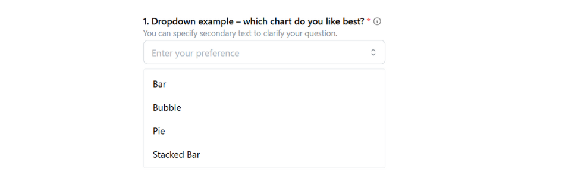

In this example, the drop-down is rendered in the main window, as indicated by the `"location": "aboveStimulus"` line. As documented in the [`BaseResponse`](../../typedoc/interfaces/BaseResponse/), the other options are `sidebar` and `belowStimulus`.

To use a prebuilt country list, set `options` to `"countries"` instead of providing an array. The menu shows country names with flag emoji, sorted alphabetically, and stores each selection as its two-letter country code. This preset also works as a multiselect dropdown when `minSelections` is positive or `maxSelections` is greater than one; use country codes for `default` and `requiredValue` values.

```json title="public/study-name/config.json"
{
  "id": "country",
  "type": "dropdown",
  "prompt": "Which country do you live in?",
  "options": "countries"
}
```

Form elements can be placed either in a sidebar, or as the main content of a study page. The sidebar version is useful if you're showing another kind of stimulus in the main part of the window. The main page location is useful for stand-alone survey questions, or if you want to integrate your response with your stimulus.

Because form elements are so commonly combined with other stimuli, a standalone questionnaire component as shown above is just a stripped down component with "only" a response.

## Validate and score a built-in response

Any response type can set `path` to a TypeScript or JavaScript module under the app's `src/public/` directory. For built-in inputs, the module supplies optional named `validate` and `score` exports; it does not replace the input UI. Validation decides whether a Participant can continue. Scoring grades an answer when the study checks it. The path is relative to `src/public/`, unlike image and stylesheet paths, which are relative to `public/`.

For example, save this module as `src/public/my-study/assets/gradeEstimate.ts`:

```ts title="src/public/my-study/assets/gradeEstimate.ts"
export function validate(value: unknown) {
  return typeof value === 'number' && value >= 0
    ? null
    : 'Enter a number of 0 or greater.';
}

export function score(value: unknown, _values: unknown, _response: unknown, expected?: unknown) {
  if (typeof value !== 'number' || typeof expected !== 'number') return 0;
  const error = Math.abs(value - expected);
  return Math.max(0, 1 - error / 10);
}
```

Then add the module path to a numerical response and an expected answer to the same component:

```json title="public/my-study/config.json (component excerpt)"
"estimate": {
  "type": "questionnaire",
  "provideFeedback": true,
  "response": [
    {
      "id": "estimate-value",
      "type": "numerical",
      "prompt": "Estimate the value shown in the chart.",
      "path": "my-study/assets/gradeEstimate.ts"
    }
  ],
  "correctAnswer": [
    {
      "id": "estimate-value",
      "answer": 50,
      "correctnessThreshold": 0.8
    }
  ]
}
```

The exports receive `(value, values, response)`; `score` also receives the optional configured `expected` answer. `values` contains answers from the component, so you can check another response, while `response` contains this response's config. A validation result of `null` or `true` passes; a nonempty string shows that error, and `false` shows a generic invalid-response message. A score may be `true` or `false` (converted to `1` or `0`), a number from `0` to `1`, or `null`. `null` falls back to ordinary `correctAnswer` matching when an answer is configured; without one, the response remains ungraded. An invalid score or a module that cannot load prevents answer checking and shows an error.

Here, an estimate of `52` scores `0.8` and meets the `0.8` threshold. `correctnessThreshold` belongs on the matching `correctAnswer` entry, accepts `0` through `1`, and defaults to `1`. A score below the threshold can still earn partial credit and appears as partially correct during answer feedback. See [Responses and Answers](./answers-trainings.md) for feedback and saved-score behavior.

A separate response-function demo shows how a custom validation message appears after an invalid answer:

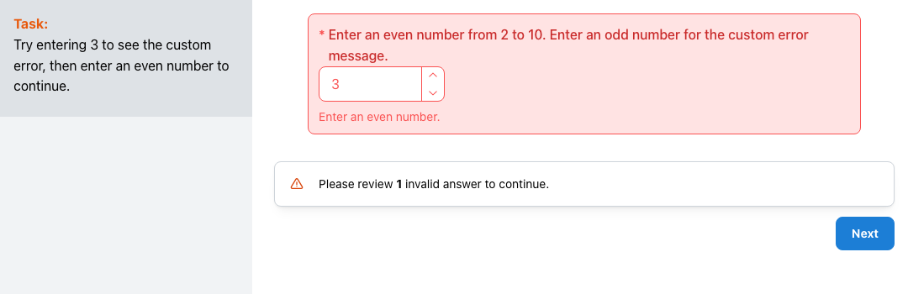

:::note
You can also add form-based responses to all other stimuli using exactly the same syntax!
:::

## Notable Features

Below we list some notable features that apply to all or most form elements.

### Prompts and Descriptions

Each form element requires a `prompt` that introduces the question. You can also provide a more detailed description in `secondaryText` that is shown below the prompt; both are demonstrated in the above example.

### Additional Descriptions

The `infoText` allows you to provide additional description for survey questions or response options that appears when participants hover over an information icon. This helps clarify questions or scales while keeping the `prompt` simple.
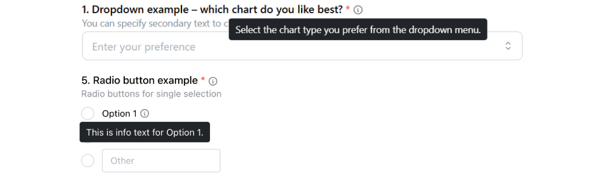

:::info
For response option, `infoText` is only supported in `button`, `checkbox`, `radio`, `dropdown`, `matrix` and `ranking` responses.
:::

### Required Fields

You can make a field required, in which case a red star is rendered (see above). Required is the default; set `"required": false` if an answer is optional.

The **Next** button is available before a Participant answers. When they select it, ReVISit checks required fields and validation rules. If anything needs attention, the page stays open, highlights the affected fields, and shows a summary of unanswered questions and invalid answers. The Participant can then correct the highlighted fields and select **Next** again.

This attempted-advance validation applies to required responses, `requiredValue`, numeric ranges, `minSelections` and `maxSelections`, matrix questions, incomplete **Other** entries, and custom response validation.


You can also force participants to provide a specific answer value using `requiredValue`. This is useful for attention checks, training tasks, or ensuring participants read instructions carefully. The participant must provide an exact match with the specified value to proceed.

For single-select responses (`radio`, `shortText`, `longText`, `numerical`, etc.), `requiredValue` requires an exact match:

```json title="public/study-name/config.json"
{
  "id": "accept",
  "prompt": "Do you consent to the study and wish to continue?",
  "requiredValue": "Accept",
  "location": "belowStimulus",
  "type": "radio",
  "options": [
    "Decline",
    "Accept"
  ]
}
```

For multi-select responses (`checkbox`, `dropdown` with multiple selections), `requiredValue` can be an array of values that must all be selected:

```json title="public/study-name/config.json"
{
  "id": "multi-check",
  "prompt": "Please select both Option 1 and Option 2",
  "type": "checkbox",
  "options": ["Option 1", "Option 2", "Option 3"],
  "requiredValue": ["Option 1", "Option 2"]
}
```

When using `requiredValue` with arrays, the system checks that the participant has selected exactly the specified values, in any order. If the participant selects different values or a different number of values, they will see a message asking them to select the required options.

`requiredLabel` does not control matching. ReVISit compares the participant's answer with `requiredValue`; `requiredLabel` only changes the human-readable validation message. This is useful when the stored value differs from the label shown to participants.

```json title="public/study-name/config.json"
{
  "id": "attention-check",
  "prompt": "Please select 'I agree' to continue",
  "type": "radio",
  "options": [
    { "label": "I agree", "value": "agree" },
    { "label": "I disagree", "value": "disagree" }
  ],
  "requiredValue": "agree",
  "requiredLabel": "I agree"
}
```

Reactive responses can also use `requiredValue` to require an exact match. Set the value to what the reactive component will report when the required action is complete:

```json title="public/study-name/config.json"
{
  "id": "complete-action",
  "type": "reactive",
  "prompt": "Complete the action before continuing.",
  "requiredValue": "ready"
}
```

For reactive and custom responses, the answer must match the configured value exactly, including its data structure when the answer is an array or object.

### Default Values

Most form elements can include a default field to set an initial answer, which is shown when the question loads and restored if the participant resets the question instead of leaving it empty. If you use `paramCapture` to get a value from the URL, that value overrides the default.

```json title="public/study-name/config.json"
{
  "id": "q-likert",
  "type": "likert",
  "prompt": "How difficult was this task?",
  "numItems": 5,
  "default": 3
}
```

For matrix questions, `default` sets a value for each row: use one string for `matrix-radio`, and for `matrix-checkbox` use a string (one choice) or a list of strings (multiple choices).

```json title="public/study-name/config.json"
{
  "id": "matrix-default",
  "type": "matrix-checkbox",
  "prompt": "Which apply to each item?",
  "questionOptions": ["Q1", "Q2"],
  "answerOptions": ["A", "B"],
  "default": {
    "Q1": ["A", "B"],
    "Q2": "A"
  }
}
```

### "Don't Know" Option

You can explicitly allow participants to state that they don't know the response with a dedicated checkbox:


To achieve that, add the `"withDontKnow": true` option to your form element.

### Dividers

You can structure your forms by adding a divider between form elements. This is useful when your study has multiple topics or transitioning between different types of tasks. To add a divider, add `"withDivider": true` to the question that you want the divider to appear after. In the following figure, there's a divider added between question 1 and 2.

```json title="public/study-name/config.json"
"response": [
  {
    "id": "q-likert",
    "type": "likert",
    "numItems": 9,
    ...
    "withDivider": true
  }
]
```

Alternatively, if you want to position dividers independently of specific questions, you can use [`DividerResponse`](/docs/typedoc/interfaces/DividerResponse.md) as a standalone response element.

```json title="public/study-name/config.json"
"components": {
  ...
  "barChart": {
    ...
    "response": [
      {
        "id": "divider",
        "type": "divider"
      }
    ]
  }
}
```

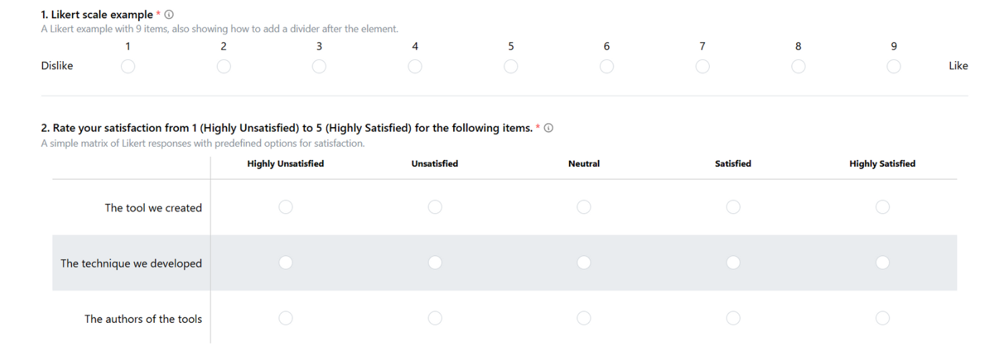

### Enumerating Questions

You can automatically number questions by setting `"enumerateQuestions": true`. This will prepend each question with its index number (starting from 1). This feature should only be used when all questions are in the same location (e.g., all questions are in the sidebar).


### Radio and Checkbox Features

Radio buttons and checkboxes have some shared noteworthy features. Here is an example showing different configurations of radio buttons:

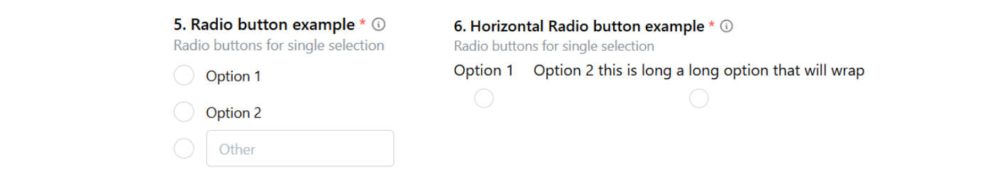

#### Vertical and Horizontal Layouts

Radios and checkboxes can be rendered either vertically (the default) or horizontally. The above figure shows radios for both. Set `"horizontal": true` to get the horizontal version.

#### "Other" Option

You can allow an "other" option for radios and checkboxes, as shown for the first radio group above. To enable that, set `"withOther": true`.

When a Participant selects **Other**, they must complete its text field before continuing. If they select **Next** without entering text, ReVISit highlights the incomplete field.

#### Selection Requirements for Checkboxes

For checkboxes, you can specify the minimum and maximum number of selections required using `minSelections` and `maxSelections`. These properties control how many options must be selected before the participant can proceed.

```json title="public/study-name/config.json"
{
  "id": "checkbox-min",
  "prompt": "Select at least 2 options",
  "type": "checkbox",
  "options": ["Option 1", "Option 2", "Option 3", "Option 4"],
  "minSelections": 2
}
```

### Matrix Features

Matrix questions let you ask several questions at the same time, using the same set of answer choices. You can either provide your own custom answers or use our built-in answer options.

For `matrix-radio` and `matrix-checkbox`, use `min` and `max` to require a minimum or limit the maximum number of answers in each row. These constraints are checked when the Participant selects **Next**.

Built-in options include:

- `likely5` or `likely7`: ranges from Highly Unlikely to Highly Likely
- `satisfaction5` or `satisfaction7`: ranges from Highly Unsatisfied to Highly Satisfied

Here is an example of Matrix Radio questions using `"answerOptions": "likely7"` and `"answerOptions": "satisfaction5"`.

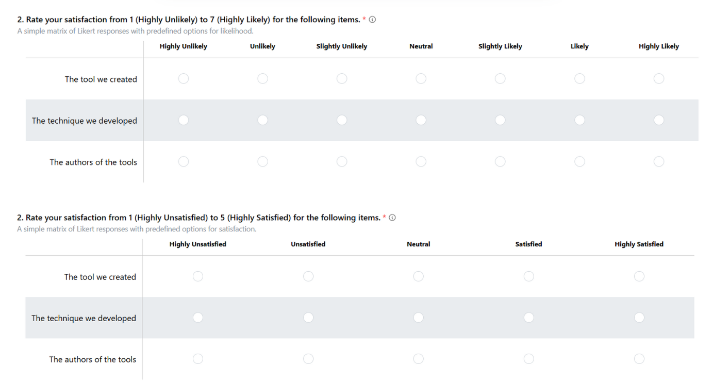

### Bipolar Matrix Row Labels

For `matrix-radio` and `matrix-checkbox`, each `questionOptions` item can be a string or an object. Use `leftLabel` and `rightLabel` on an object to place opposing terms at the left and right ends of a row without changing the value stored for that row.

```json title="public/study-name/config.json"
{
  "id": "ueq-response",
  "type": "matrix-radio",
  "answerOptions": ["1", "2", "3", "4", "5", "6", "7"],
  "questionOptions": [
    {
      "label": "Obstructive - Supportive",
      "value": "obstructive-supportive",
      "leftLabel": "Obstructive",
      "rightLabel": "Supportive"
    }
  ]
}
```

- `label` is the fallback display label.
- `value` is the optional key stored in the Participant's response and defaults to `label`.
- `leftLabel` replaces `label` at the left end of the row when supplied.
- `rightLabel` adds a label at the right end. The right-hand label column appears when at least one matrix row has a `rightLabel`; rows without one leave that cell empty.

Matrix row randomization and saved answers continue to use `value`, so adding left and right display labels does not change existing response keys.

If a Participant selects **Next** with a matrix question unanswered, they will see a validation message: "Please answer all questions in the matrix to continue."

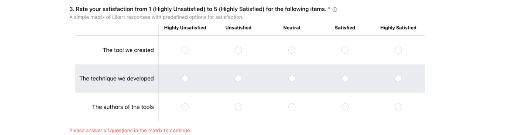

For `matrix-radio` and `matrix-checkbox`, setting `"withDontKnow": true` adds an "I don't know" column on the right side of the matrix, separated from the other answer options by a vertical line. In `matrix-checkbox`, selecting "I don't know" deselects any other answers in that row, and selecting any other option deselects "I don't know".

### Dropdown Features

A dropdown allows participants to choose one or more from a list. By default, they can only pick one item. If you want to allow multiple selections, add `minSelections` or `maxSelections` and the dropdown will then automatically become a multiselect dropdown.

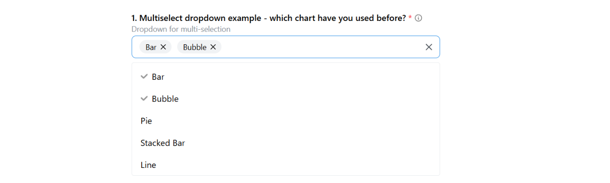

When `minSelections` or `maxSelections` are specified for a dropdown, it automatically becomes a multiselect dropdown, allowing participants to choose multiple options.

Example with minimum selections:

```json title="public/study-name/config.json"
{
  "id": "dropdown-multi",
  "prompt": "Select at least 2 options",
  "type": "dropdown",
  "options": ["Option 1", "Option 2", "Option 3", "Option 4"],
  "minSelections": 2
}
```

Example with both minimum and maximum:

```json title="public/study-name/config.json"
{
  "id": "dropdown-range",
  "prompt": "Select between 2 and 3 options",
  "type": "dropdown",
  "options": ["Option 1", "Option 2", "Option 3", "Option 4"],
  "minSelections": 2,
  "maxSelections": 3
}
```

### Likert Features

A Likert response allows participants to rate something on a scale. You can customize the scale in several ways -- you can set where the scale starts, how large the steps between values are, the label locations, and how many options it has.

For example, here is a Likert example with `"start": 1`, `"spacing": 2`, and `"numItems": 10`.


You can control the label location in Likert responses to better fit your layout. The `labelLocation` property supports multiple options: `above`, `inline` (default), and `below`. The `above` and `below` options are useful when the width of the section containing the Likert question is limited and the `inline` layout does not work well.

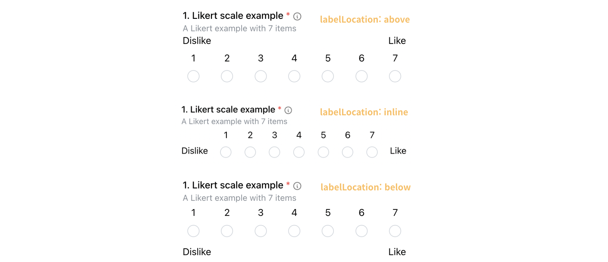

### Numerical Response Features

Numerical response inputs support `min` and `max` fields that define the acceptable range of values for the answer. These constraints help ensure that participants provide values within the expected bounds, and warnings will be displayed if their input falls outside this range.

```json title="public/study-name/config.json"
{
  "id": "q-numerical",
  "prompt": "Numerical example",
  "location": "aboveStimulus",
  "type": "numerical",
  "placeholder": "Enter your age, range from 0 - 120",
  "max": 120,
  "min": 0
}
```

The `min` and `max` properties work together to define an inclusive range. To exclude the boundary values, use `strictMin` and/or `strictMax`; a value must be greater than `strictMin` and less than `strictMax`.

```json title="public/study-name/config.json"
{
  "id": "age",
  "type": "numerical",
  "prompt": "Enter an age greater than 18 and less than 65.",
  "strictMin": 18,
  "strictMax": 65
}
```

When a Participant tries to continue with a value outside the configured range, ReVISit displays a validation message and keeps the page open.

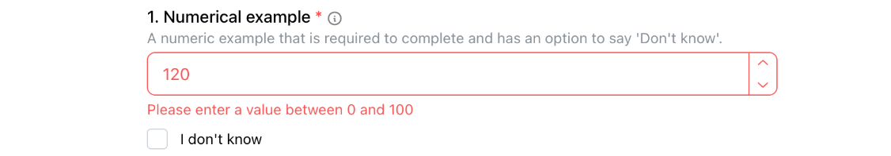

You can also define a range of acceptable answers using the `acceptableLow` and `acceptableHigh` properties in the `Answer` interface. This is particularly useful for numerical answers where you want to accept values within a certain range rather than requiring an exact match.

```json title="public/study-name/config.json"
{
  "correctAnswer": [{
    "id": "q-numerical",
    "answer": 5,
    "acceptableLow": 4,
    "acceptableHigh": 6
  }]
}
```

For example, if the correct answer is 5, and you set `acceptableLow` to 4 and `acceptableHigh` to 6, then any answer between 4 and 6 (inclusive) will be considered correct. This is useful for questions where there might be slight variations in correct answers, or where you want to account for rounding or measurement precision.

### Slider Features

A slider response lets participants pick a value by moving a handle on a line. You can change how the slider works by setting where it starts, how big each step is, and how far apart the tick marks are.
Here is a slider example with `"step": 10` and `"spacing": 10`.


You can also hide the label above the handle by using `snap`, and choose whether to show the bar with `withBar`.
The example below shows a slider with `"snap": true` and `"withBar": false`.


### Ranking Widget Features

A ranking widget allows participants to order or group items rather than simply selecting them. They are useful when you want to capture relative preferences, priorities, or categories of interest.

#### The "numItems" option

For sublist and categorical rankings, you can use the `numItems` option to control how many items participants must assign:

- In a sublist, `numItems` sets how many items they have to rank (e.g., top 2 out of 5).
- In a categorical ranking, `numItems` can limit how many items may be placed in each category (e.g., only 3 items per category).

:::info
The `numItems` option cannot be used in pairwise rankings, since their purpose is to compare and rank items by pairs.
:::

This option is useful when you want participants to focus on their strongest preferences rather than distributing all items.

#### Pairwise ranking validation

In a `ranking-pairwise` response, a complete pair has exactly one item in **HIGH** and one different item in **LOW**. A required pairwise ranking must contain at least one complete pair before the Participant can continue. If the Participant creates additional pairs, every pair must be complete or removed before continuing.

For all ranking types, set `min` and `max` to require or limit the number of items ranked. For `ranking-sublist`, these values count ranked items; for `ranking-categorical`, they count items within each category; for `ranking-pairwise`, they count pairs. `categorizeAll: true` on `ranking-categorical` also requires every item to be assigned to a category.

ReVISit prevents the following invalid arrangements and displays an error explaining what to correct:

- placing more than one item in either side of a pair;
- placing the same item in both **HIGH** and **LOW**;
- creating the same pair more than once; or
- leaving a pair unfinished.

For all three ranking types, the widget becomes read-only after the response is finalized: items can no longer be dragged, and any applicable controls for adding or removing pairs are disabled.

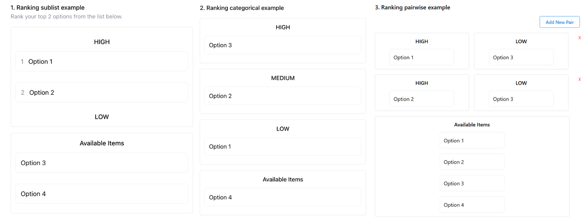

## Date and Time Responses

Use `date` when a Participant should enter a calendar date, month, or year. The `options` field selects the input: `date` (default), `month`, or `year`. Values are stored as strings in `MM/DD/YYYY`, `MM/YYYY`, or `YYYY` format, respectively. Set `min`, `max`, `default`, or `requiredValue` using the same format as the selected option. Supported years range from `0100` through `9999`.

```json title="public/study-name/config.json"
{
  "id": "study-date",
  "prompt": "When did you first use the tool?",
  "type": "date",
  "options": "month",
  "min": "01/2020",
  "max": "12/2026"
}
```

Use `time` for a time of day. Set `format` to `12h` or `24h` for the display; ReVISit always stores time in 24-hour `HH:mm` format. Set `withSeconds` to `true` to include seconds, which changes the stored format to `HH:mm:ss`. The `min`, `max`, `default`, and `requiredValue` values must use the matching 24-hour format.

## Conditional Responses

Set `visibleIf` on a response to show it only when another response in the same component meets a condition. The controlling response must have an answer, and it must itself be visible. If a response becomes hidden, ReVISit removes its answer from the component's current response data. This prevents a hidden follow-up answer from being submitted or used to reveal another response.

```json title="public/study-name/config.json"
"response": [
  {
    "id": "attended-university",
    "type": "radio",
    "prompt": "Did you attend university?",
    "options": [
      { "label": "Yes", "value": "yes" },
      { "label": "No", "value": "no" }
    ]
  },
  {
    "id": "university-name",
    "type": "shortText",
    "prompt": "Which university?",
    "visibleIf": {
      "responseId": "attended-university",
      "comparison": "equals",
      "value": "yes"
    }
  }
]
```

The available comparisons are `equals`, `doesNotEqual`, `contains`, `doesNotContain`, `matchesRegex`, `lessThan`, `lessThanOrEqual`, `greaterThan`, `greaterThanOrEqual`, and `isCorrect`. Numeric comparisons require a numerical controller; `isCorrect` can use a matching entry in the component's `correctAnswer` or a scoring module configured through that response's `path`. Equality on checkbox selections ignores selection order. A response cannot refer to itself or form a visibility cycle.

## Delayed Responses

Set `delay` on a response to keep that form element disabled for a number of milliseconds after its component appears. The value must be zero or greater; the default is `0` (no delay). A delay does not automatically advance the Participant or extend a component timeout.

```json title="public/study-name/config.json"
{
  "id": "delayed-rating",
  "prompt": "Rate the chart after reviewing it.",
  "type": "likert",
  "numItems": 5,
  "delay": 5000
}
```

## Clear a Selected Answer

Radio, button, and matrix responses show a **Clear selection** control after a Participant makes a selection. It lets them remove the current selection and choose again. The control is disabled when the response is disabled, including while a configured `delay` is active.

## Keyboard Shortcuts for Button Responses

For a `buttons` response, use object options and set `key` to a shortcut that selects that option. The shortcut appears beside the option label. This can help Participants who use a keyboard or support timed tasks where fast responses matter.

```json title="public/study-name/config.json"
{
  "id": "color",
  "prompt": "Which color is shown?",
  "type": "buttons",
  "options": [
    { "label": "Red", "value": "red", "key": "r" },
    { "label": "Blue", "value": "blue", "key": "b" }
  ]
}
```

Keys can be ordinary characters or named keys such as `ArrowLeft`, and can include modifiers such as `Shift+X`. ReVISit ignores repeated key events and does not use Tab, Ctrl, or Meta shortcuts. See [Keyboard and Gamepad Input](./input-devices.md) for the broader input-recording options.

## Built-In Short-Text Validation

Set `builtInValidation` on a `shortText` response to check a common format. Supported values are `email`, `phoneNumber` (an international number with 7–15 digits), `usPhoneNumber` (10 digits in `000-000-0000` format), and `url` (an absolute HTTP or HTTPS URL). ReVISit checks the value when the Participant continues and shows an error if it does not match the selected format.

## Custom Text Validation

Use `textValidation` on a `shortText` or `longText` response to apply one or more text rules. The rules are checked in order, and the first failing rule determines the message shown when the Participant tries to continue.

```json title="public/study-name/config.json"
{
  "id": "study-code",
  "type": "shortText",
  "prompt": "Enter your study code.",
  "textValidation": [
    { "type": "matchesRegex", "value": "^[A-Z]{2}-[0-9]{4}$" },
    { "type": "doesNotEqual", "value": "XX-0000" }
  ]
}
```

Supported rule types are `matchesRegex`, `contains`, `doesNotContain`, `equals`, and `doesNotEqual`. For `matchesRegex`, the pattern is tested against the response; use `^` and `$` anchors when the entire value must match. See the [MDN regular expression guide](https://developer.mozilla.org/en-US/docs/Web/JavaScript/Guide/Regular_expressions/Cheatsheet) for pattern syntax.

## Randomization of form elements

Randomizing the order of answers or questions can help reduce bias and improve the quality of your study results. ReVISit allows you to shuffle options within a question, or even the order of entire questions on a page.

A die icon is shown in the sidebar to indicate that at least one item on this page has a randomized order.

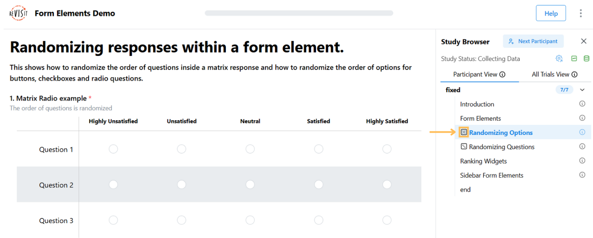

Each participant will see their own consistent order during the study, and the same order is recorded and shown in the replay, so you can always see exactly what they saw.

### Randomizing Matrix Checkbox, Matrix Radio

For matrix questions (e.g., matrix radio or matrix checkbox), you can randomize the questions. Set `"questionOrder": "random"` to randomize questions.

Here is an example to show how to set up questions in random order:

```json title="public/study-name/config.json"
"response": [
  {
    "id": "5items-response",
    "prompt": "To what extent do you agree that this visual representation is...?",
    "location": "belowStimulus",
    "type": "matrix-radio",
    "answerOptions": "satisfaction5",
    "questionOrder": "random", // Set randomization here
    "questionOptions": [
        "enjoyable",
        "likable",
        "pleasing",
        "nice",
        "appealing"
    ]
  }
]
```

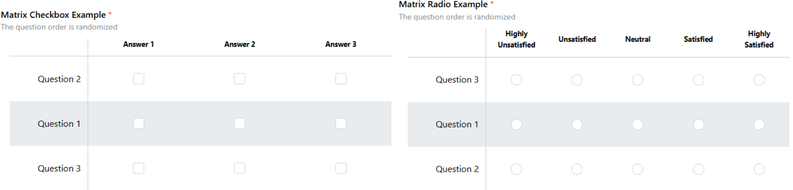

### Randomizing Checkbox, Radio, Button

To shuffle the options in a radio, checkbox, or button question, set `"optionOrder": "random"`.

Here is an example to show how to set up options in random order:

```json title="public/study-name/config.json"
"response": [
  {
    "id": "fruitPreference",
    "prompt": "What’s your favorite fruit?",
    "location": "aboveStimulus",
    "type": "radio",
    "optionOrder": "random", // Set randomization here
    "options": [
        "Apple",
        "Banana",
        "Grape"
    ]
  }
]
```

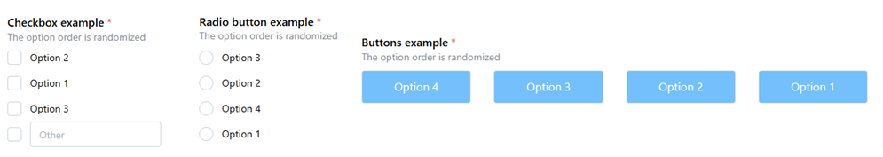

### Randomizing form elements in a single page

You can randomize the order of multiple questions that appear on the same page by setting `"responseOrder": "random"`, which will shuffle the order in which the form elements themselves appear on the page. In some cases, however, you may want certain responses to stay in a fixed position. To exclude a specific response from randomization, set `"excludeFromRandomization": true` on that response element. This setting overrides the component-level `responseOrder` configuration and ensures the specified response maintains its original position while other responses are randomized.

Here is an example to show how to set up responses in random order:

```json title="public/study-name/config.json"
"survey_randomized_form": {
  "type": "questionnaire",
  "responseOrder": "random", // Set randomization here
  "response": [
    {
      "id": "demographics",
      "prompt": "What is your gender?",
      "type": "shortText",
      "placeholder": "Enter your answer",
      "excludeFromRandomization": true // Exclude from randomization here
    },
    {
      "id": "duration",
      "prompt": "How long have you used this website?",
      "type": "shortText",
      "placeholder": "Enter your answer"
    },
    {
      "id": "favoriteFeature",
      "prompt": "What's your favorite feature?",
      "type": "shortText",
      "placeholder": "Enter your answer"
    },
    {
      "id": "recommend",
      "prompt": "Would you recommend our app?",
      "type": "dropdown",
      "options": [
        "Yes",
        "No"
      ]
    }
  ]
}
```
If the form is randomized, a die icon will appear in the sidebar to indicate that the response order is random.

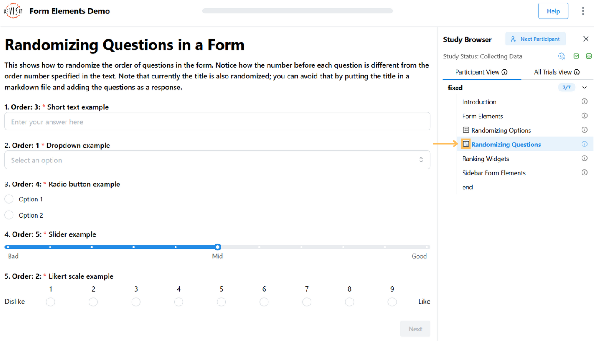

## Sidebar Configuration

The sidebar is a left panel that can be used to display form elements alongside your stimulus. This is particularly useful when you want participants to see both the stimulus and the questions simultaneously.

### Enabling the Sidebar

To use the sidebar, you must set `"withSidebar": true` in your component or globally in the `uiConfig`. The sidebar is required if any of your responses have `"location": "sidebar"`.

```json title="public/study-name/config.json"
"components": {
  "survey": {
    "type": "questionnaire",
    "withSidebar": true,
    "response": [
      {
        "id": "q-sidebar",
        "prompt": "Rate this visualization",
        "location": "sidebar",
        "type": "likert",
        "numItems": 5
      }
    ]
  }
}
```

### Sidebar Width

You can customize the width of the sidebar by setting `"sidebarWidth"` (in pixels). The default width is 300 pixels. This can be set globally in `uiConfig` or overridden on individual components.

```json title="public/study-name/config.json"
"components": {
  "survey": {
    "type": "questionnaire",
    "withSidebar": true,
    "sidebarWidth": 400,
    "response": [
      {
        "id": "q-sidebar",
        "prompt": "Rate this visualization",
        "location": "sidebar",
        "type": "likert",
        "numItems": 5
      }
    ]
  }
}
```

For more details on sidebar configuration, see the [`UIConfig`](../../typedoc/interfaces/UIConfig/) and [`BaseIndividualComponent`](../../typedoc/interfaces/BaseIndividualComponent/) documentation.

import StructuredLinks from '@site/src/components/StructuredLinks/StructuredLinks.tsx';

<StructuredLinks
  demoLinks={[
    {name: "Form Elements Demo", url: "https://revisit.dev/study/demo-form-elements"}
  ]}
  codeLinks={[
    {name: "Form Elements Code", url: "https://github.com/revisit-studies/study/blob/main/public/demo-form-elements/"}
  ]}
  referenceLinks={[
    {name: "Answer", url: "../../typedoc/interfaces/Answer"},
    {name: "BaseResponse", url: "../../typedoc/interfaces/BaseResponse"},
    {name: "ButtonsResponse", url: "../../typedoc/interfaces/ButtonsResponse"},
    {name: "CheckboxResponse", url: "../../typedoc/interfaces/CheckboxResponse"},
    {name: "DividerResponse", url: "../../typedoc/interfaces/DividerResponse"},
    {name: "DropdownResponse", url: "../../typedoc/interfaces/DropdownResponse"},
    {name: "LikertResponse", url: "../../typedoc/interfaces/LikertResponse"},
    {name: "LongTextResponse", url: "../../typedoc/interfaces/LongTextResponse"},
    {name: "MatrixResponse", url: "../../typedoc/interfaces/MatrixResponse"},
    {name: "NumericalResponse", url: "../../typedoc/interfaces/NumericalResponse"},
    {name: "RadioResponse", url: "../../typedoc/interfaces/RadioResponse"},
    {name: "RankingResponse", url: "../../typedoc/interfaces/RankingResponse"},
    {name: "ShortTextResponse", url: "../../typedoc/interfaces/ShortTextResponse"},
    {name: "SliderResponse", url: "../../typedoc/interfaces/SliderResponse"},
  ]}
/>
