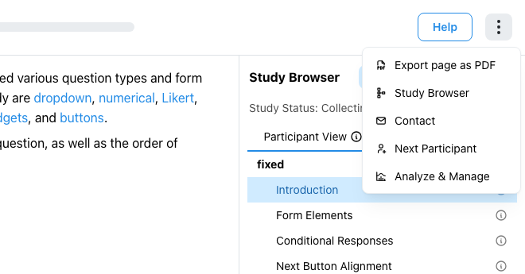

# Preview and Export a Study Page

While previewing or taking a study, you can save the current page as a PDF. Open **Study actions** (the three-dot menu in the page header) and select **Export page as PDF**. ReVISit exports the current component as it is rendered, including visible response controls and any displayed selections. It does not export the full study or provide structured participant data.

The export waits for page content and media to render, then downloads a PDF named for the current component. If the page contains an external website, ReVISit cannot export it and displays a message explaining the limitation. Very large media or a page that fails to render may also prevent export.

:::note
The PDF represents the page as it is displayed at the time of export. It is useful for sharing or printing study materials, but it is not a substitute for the Study Config or collected data.
:::
