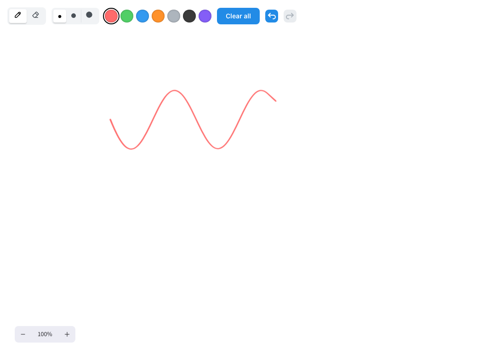

# Drawing Library

The `drawing` library adds a freehand canvas that saves a drawing response and records drawing history for participant replay. Import it in the Study Config, then use the canvas component or the ready-made sequence.

```json title="public/study-name/config.json"
{
  "importedLibraries": ["drawing"],
  "components": {
    "sketch": {
      "baseComponent": "$drawing.components.canvas",
      "parameters": {
        "responseId": "drawing",
        "initialColor": "red",
        "initialPenSize": "m",
        "requireDrawing": true
      }
    }
  },
  "sequence": {
    "order": "fixed",
    "components": ["sketch"]
  }
}
```

Alternatively, include `"$drawing.sequences.drawing"` in `sequence.components` to use the default canvas without defining a local component.

The canvas fills the available study area by default. Set `height` to a fixed height in pixels. You can seed it with an Excalidraw scene using `initialDrawing`. The default `responseId` is `drawing`; if you change it, update the hidden reactive response ID in the component as well. `requireDrawing: true` requires at least one visible, nondeleted drawing element before the Participant can continue.

Participants can draw with the pen or eraser, choose from seven ink colors and three pen sizes, and clear, undo, or redo gestures. The saved response contains the Excalidraw scene (`elements`, `appState`, and `files`). Returning to a task with **Previous** restores its current drawing; a new trial starts with the configured initial drawing. ReVISit's replay records the drawing's provenance, including tool and style changes.



See the [drawing library source and runnable example](https://github.com/revisit-studies/study/tree/dev/public/library-drawing) for a complete example.
