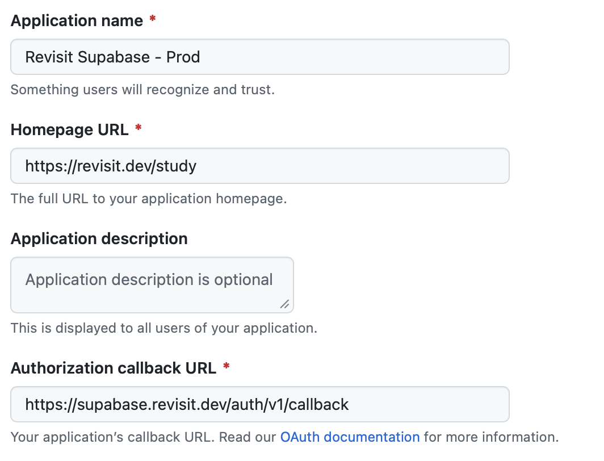
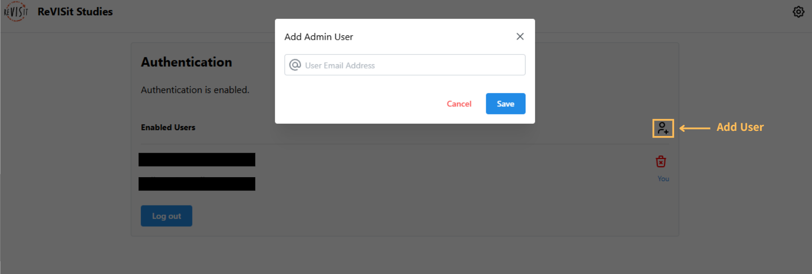
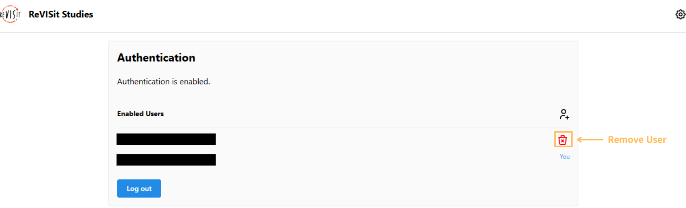

# Setting Up Authentication

:::warning
Configure your Supabase deployment before enabling authentication; see [Configuring Supabase](./setup.md). Existing MinIO or pgsty installations must follow the [migration guide][supabase-migration] before using the new deployment configuration.
:::

## Enabling Authentication in Supabase

Supabase provides a variety of authentication methods.

:::info
Supabase supports multiple OAuth providers, but reVISit currently only officially supports GitHub OAuth. For other providers, see the [Supabase self-hosted authentication guide](https://supabase.com/docs/guides/self-hosting/auth).
:::

To enable GitHub OAuth, start by [creating a GitHub OAuth application](https://github.com/settings/developers).

Give your application a name, such as `ReVISit Supabase`. For the "Homepage URL", enter the URL where your reVISit application will be hosted (e.g., `https://my-revisit-app.com`). This must include the `https://` prefix.

Lastly set the "Authorization callback URL" to `https://<your-supabase-domain>/auth/v1/callback`, replacing `<your-supabase-domain>` with your actual Supabase domain (e.g., `https://supabase.organization.com/auth/v1/callback`).



After creating the OAuth application, copy its Client ID and generate a Client Secret. Edit the `.env` in your **separate Supabase deployment directory**, not the reVISit application's `.env`:

```env title="Supabase deployment .env"
ENABLE_GITHUB_OAUTH=true
GITHUB_OAUTH_CLIENT_ID=<your-github-client-id>
GITHUB_OAUTH_SECRET=<your-github-client-secret>
GITHUB_OAUTH_REDIRECT_URI=https://<your-supabase-domain>/auth/v1/callback
API_EXTERNAL_URL=https://<your-supabase-domain>/auth/v1
SITE_URL=https://<your-revisit-domain>/<application-path>
```

Use the exact callback URL registered with GitHub. Set `SITE_URL` to your reVISit application's URL, including its path if applicable, and retain any required `ADDITIONAL_REDIRECT_URLS`. `API_EXTERNAL_URL` is the full Supabase Auth endpoint, including `/auth/v1`. During migration, preserve the registered callback and existing secrets as described in the migration guide.

The upstream bundle needs reVISit's GitHub override to read these settings. From the Supabase deployment directory, copy the override from your matching reVISit checkout, enable it, and start the updated configuration:

```bash
cp /absolute/path/to/revisit-study/supabase/docker-compose.github.yml .
sh run.sh config add github
sh run.sh start
```

See the [complete self-hosted setup guide][supabase-setup] for deployment and key-generation instructions. Keep the client secret private and out of the application's public `VITE_*` variables.

## Enabling Authentication in reVISit

Through the settings cog on the right of your reVISit application, navigate to the "settings" page. Here, you will see that authentication will be currently disabled with a button to enable authentication.

When you first enable authentication, you will be prompted to sign in with GitHub OAuth. ReVISit verifies the signed-in GitHub account with Supabase and adds it as the first administrator. Confirm the account shown in the setup prompt before enabling authentication. Other accounts must be added as administrators before they can access protected analysis and settings pages.

## Manage Administrators in reVISit

### Adding Additional Users

To add another administrator, navigate to the settings page and select the **Add User** icon beside **Enabled Users**. Enter the email address associated with that person's GitHub account and save. They can then sign in with that account to access protected pages.



### Removing A User

In the "Enabled Users" section, you will see the "delete" icon to the right of each user aside from yourself. Any administrator is capable of deleting any user from the reVISit system. The only restriction is that you cannot delete yourself and there can never be less than one user.



import StructuredLinks from '@site/src/components/StructuredLinks/StructuredLinks.tsx';

<StructuredLinks
    referenceLinks={[
        {name: "Supabase Setup", url: "../setup"},
        {name: "Supabase Authentication", url: "https://supabase.com/docs/guides/auth"},
    ]}
/>

[supabase-setup]: https://github.com/revisit-studies/study/blob/1669a47fa63860b39723b4e92a10f73dbbb8936c/supabase/README.md
[supabase-migration]: https://github.com/revisit-studies/study/blob/1669a47fa63860b39723b4e92a10f73dbbb8936c/supabase/MIGRATION.md
