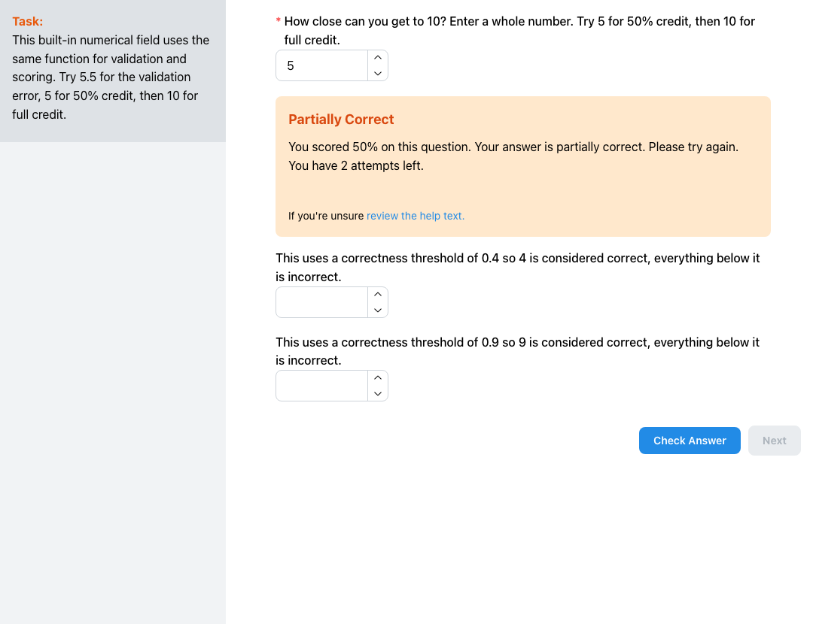
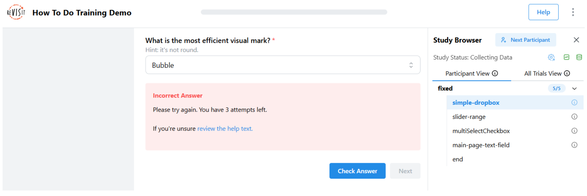
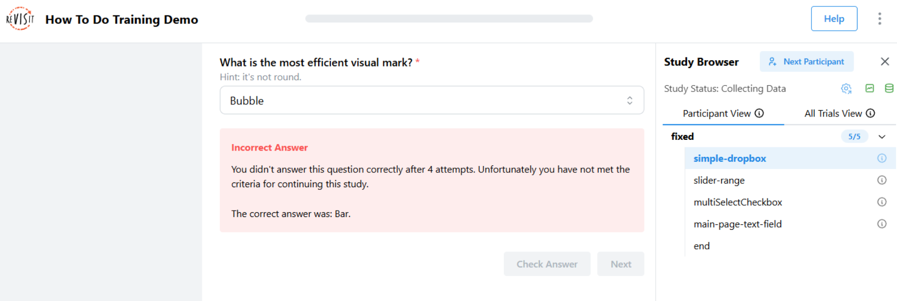
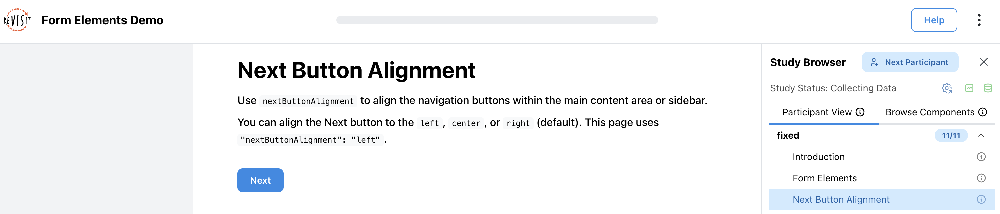
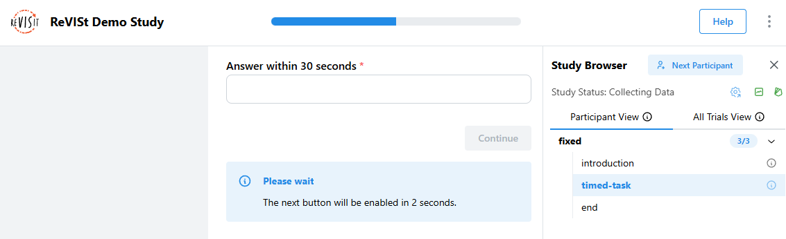
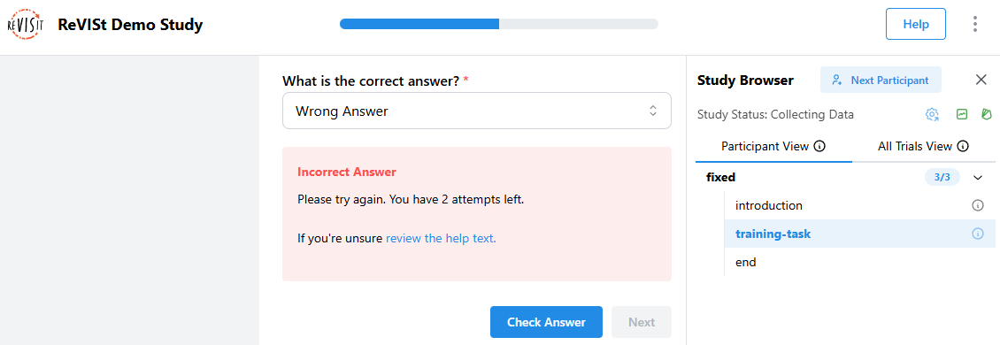
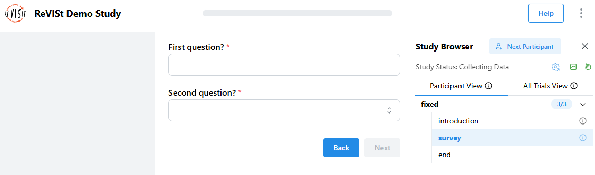

# Responses and Answers

In reVISit, a [component](../../typedoc/interfaces/BaseIndividualComponent) typically has a [response](../../typedoc/interfaces/BaseResponse) that is recorded when a participant completes a task. Responses can be provided via form elements or via some other kind of payload through your custom component and a [ReactiveResponse](../../typedoc/interfaces/ReactiveResponse).

Responses can optionally also be provided with an [Answer](../../typedoc/interfaces/Answer) that captures what the correct response is, or with a scoring module at the response's `path`. These are used in several ways:

 * A checked response can be marked correct or incorrect; a custom scorer can also save a fractional score for export.
 * In the analysis interface, tasks will be shown as correct or incorrect depending on the answer.
 * Answers can be used to check the response during the experiment, which is useful for **training**.

### Understanding Response Status

When a response has neither a matching `correctAnswer` nor a scoring module, reVISit cannot evaluate whether it is correct. In sidebars and the Analyst task timeline, that response is shown with a gray checkmark and the tooltip “Response recorded; correctness not configured.” The gray checkmark confirms that the response was recorded; it does not indicate a correct answer. A green checkmark indicates a correct answer, and a red X indicates an incorrect answer.


:::info
For answers with degrees of correctness, attach a `score` module to the response's `path`. It can return a fractional score from `0` to `1`; a matching `correctAnswer` entry can set the minimum `correctnessThreshold` for treating that score as correct. See [Validate and score a built-in response](./forms.md#validate-and-score-a-built-in-response).
:::

## Specifying Answers and Trainings

When you develop an online study, it's often important to train participants well before they can take a study. Typically, you want to give them an example task, but also provide help and hints at first. Here we lay out possibilities to develop trainings in reVISit leveraging responses and answers.

For a working example, refer to [the demo](https://revisit.dev/study/demo-training/) and the [associated config](https://github.com/revisit-studies/study/tree/main/public/demo-training).

Here's a simple dropdown component asking what the most efficient visual mark is. The `correctAnswer` field contains an answer for the `q-mark-type` response that specifies that the correct answer is `Bar`.

An answer can include more than one accepted value. Use `acceptableAnswers` when several responses should be marked correct. You may also set `caseSensitive` and provide answer-specific `feedback`:

```json title="public/study-name/config.json"
"correctAnswer": [
  {
    "id": "q1",
    "answer": "Bar",
    "acceptableAnswers": ["bar chart", "bar graph"],
    "caseSensitive": false,
    "feedback": {
      "correctText": "That's right.",
      "incorrectText": "Look for the option that makes values easy to compare."
    }
  }
]
```

`answer` may be omitted when `acceptableAnswers` or a numeric bound defines the accepted response. Keep each answer's `id` matched to a response ID.

For checkbox and matrix responses, ReVISit can mark a response **partially correct** when it contains some, but not all, of the expected selections. The participant sees “Partially Correct” by default. A partial response is not treated as correct for training progression or the overall correct/incorrect result. For alternatives that should each count as fully correct, list each complete accepted response in `acceptableAnswers`; do not use it to describe partial credit.

A response with a `score` export can be graded even when the component has no `correctAnswer` entry. Set `provideFeedback: true` on the component to let Participants check that scorer-only response. Without an expected answer, the scorer's fourth argument is `undefined`, and the correctness threshold is the default `1`. If you need a lower threshold, add a matching `correctAnswer` entry with `correctnessThreshold` from `0` to `1` (default `1`). A score at or above the threshold counts as correct. A positive score below it is shown as **Partially Correct**, with the rounded percentage in feedback, but does not pass training. A score of `0` is incorrect. The same threshold determines `visibleIf` comparisons using `isCorrect`.



The Analyst timeline and sidebar correctness status use the checked result; the tidy CSV `score` column holds saved fractional custom scores as rounded percentage text. See [Data Export](../analysis/data-export.md#download-as-tidy-csv). When a Participant selects **Next**, ReVISit calculates and saves a custom score for an answered response with a scoring module, even if the Participant did not select **Check Answer** and even if the response has no `correctAnswer`. **Check Answer** can save the score earlier. A blank tidy `score` means no custom score was saved for that response, such as when it was unanswered or had no scoring module.

Feedback can use a string or an array of messages for `correctText`, `incorrectText`, and `exhaustedText`. Arrays show the first message on the first answer-check attempt, then the next message on each attempt; the last message repeats for later attempts. Use `{attemptsUsed}` and `{attemptsLeft}` in a message to include the number of attempts used and remaining. `hints` can provide a progressive hint on each incorrect attempt while attempts remain; its last entry repeats on later attempts. `exhaustedText` replaces the incorrect message after the final attempt.

```json title="public/study-name/config.json"
"correctAnswer": [
  {
    "id": "q1",
    "answer": "Paris",
    "feedback": {
      "correctText": "Correct!",
      "incorrectText": [
        "Not quite. You have {attemptsLeft} attempts left.",
        "Try again; you have {attemptsLeft} attempt(s) left."
      ],
      "exhaustedText": "The correct answer is Paris.",
      "hints": ["It is in Europe.", "It is the capital of France."]
    }
  }
]
```

```json title="public/demo-training/config.json"
"simple-dropbox": {
  "type": "questionnaire",
  "response": [
    {
      "id": "q-mark-type",
      "type": "dropdown",
      "required": true,
      "prompt": "What is the most efficient visual mark?",
      "secondaryText": "Hint: it's not round.",
      "placeholder": "Choose mark",
      "options": [
        "Bar",
        "Bubble",
        "Pie",
        "Stacked Bar"
      ]
    }
  ],
  "correctAnswer": [
    {
      "id": "q-mark-type",
      "answer": "Bar"
    }
  ],
  "provideFeedback": true,
  "allowFailedTraining": false,
  "trainingAttempts": 4
}
```

The last three lines specify that this is used for training:

The `provideFeedback` field adds a "Check Answer" button to the UI, which checks the configured answer or response scorer.



The above screenshot shows an example for when the response was incorrect.

Optionally, you can specify that trainings have to be successfully completed with the `allowFailedTraining` flag. You can specify the number of attempts with the `trainingAttempts` field. When failing is not allowed and the participant exceeds the number of failed attempts, **the study will terminate**.


If a user fails the training and `allowFailedTraining` is set to `false`, they’ll automatically be marked as rejected. After a 5-second delay, they’ll be taken to a "Training Failed" page that informs them that they didn’t meet the training requirements and cannot continue with the study.

## Navigation Buttons

You can customize the behavior and appearance of navigation buttons in your study components. These options can be set globally in the `uiConfig` or overridden on individual components.

### Alignment

Use `nextButtonAlignment` to align the navigation action group—Previous, Check Answer, and Next—at the left, center, or right of its current location. The default is `"right"`. This setting changes only the group's alignment; it does not change the order, location, or behavior of the buttons.

Set it in `uiConfig` to use the same alignment throughout the study. Set it on an individual component to override the global value for that component. Study Config validation accepts only `"left"`, `"center"`, and `"right"`.

To see a left-aligned **Next** button, open the [Form Elements Demo](https://revisit.dev/study/demo-form-elements) and go to **Next Button Alignment** page. See the [demo's Study Config](https://github.com/revisit-studies/study/blob/main/public/demo-form-elements/config.json) for the configuration.

```json title="public/study-name/config.json"
{
  "uiConfig": {
    "nextButtonAlignment": "center"
  },
  "components": {
    "consent": {
      "type": "questionnaire",
      "nextButtonAlignment": "left",
      "response": []
    }
  }
}
```



### Next

The next button offers several customization options. You can change the button text using `nextButtonText` (e.g., "Continue", "Next Question") and control its location with `nextButtonLocation`.

ReVISit automatically disables **Next** while the current stimulus asset is loading or has a detected loading failure. This also blocks forward navigation with Enter, automatic advancement, and the timeout **Proceed** action. **Previous** remains available when configured. Once the asset loads successfully, the component's response validation and timing settings apply. See [When a Stimulus Cannot Load](#when-a-stimulus-cannot-load) for supported stimuli and recovery steps.

To enable keyboard navigation, set `nextOnEnter` to `true`, which allows participants to press Enter to move to the next question. In a training component where **Check Answer** is available, Enter checks the answer first; otherwise, it moves to the next question.

For timing control, you can use `nextButtonEnableTime` to delay when the button becomes clickable, which helps ensure participants have time to read the content, and `nextButtonDisableTime` to set a time limit after which the button becomes disabled, which is useful for time-limited tasks.

You can also combine `nextButtonDisableTime` with `timeoutReject` to automatically reject participants who do not click the next button within the time limit. This setup is useful for enforcing strict time constraints in tasks or training phases.

Stimulus loading does not pause these timers, including rejection through `timeoutReject`.



```json title="public/study-name/config.json"
"uiConfig": {
  ...
  "timeoutReject": true
},
"components": {
  "timed-task": {
    "type": "questionnaire",
    "nextButtonText": "Continue",
    "nextOnEnter": true,
    "nextButtonEnableTime": 2000,
    "nextButtonDisableTime": 30000,
    "response": [
      {
        "id": "q1",
        "prompt": "Answer within 30 seconds",
        "type": "shortText"
      }
    ]
  }
}
```

#### When a Stimulus Cannot Load

When ReVISit detects a loading failure, it shows an inline **404** message and keeps **Next** disabled. This applies to Markdown files, images, videos, embedded HTML or websites, React stimuli, and Vega specifications loaded from a file. No additional Study Config option is needed. The check covers the stimulus ReVISit loads, not every image or data file loaded separately by your custom HTML or React code.

To resolve a failure:

1. Compare the path in the error message with the component's `path`. If you use [templating](./templating.md), check the resulting path for the affected trial.
2. Confirm that the file exists, including matching capitalization. Local Markdown, image, video, HTML, and Vega paths are relative to `public/`; React stimulus paths are relative to `src/public/`.
3. For a hosted study, confirm that the file was deployed. For external content, check that the URL works and the provider allows embedding.
4. Correct the file or path, rebuild and redeploy if needed, then reload the affected page and confirm that the stimulus appears and normal navigation resumes.

Browsers do not expose every loading failure for websites embedded from another domain. **Next** may become available even if an external website displays an error or a blank page, so preview it in the deployed study before collecting data. YouTube and Vimeo videos use readiness and error signals from their players.

For contact guidance on error screens, see [Set a Contact Email for Error Pages](./parser-errors.md#set-a-contact-email-for-error-pages).

### Automatically Advance After a Timeout

To move a Participant to the next component after a time limit, set `nextButtonAutoAdvanceTime` on an individual component. You can also set these fields in a `baseComponents` entry and inherit them in components that use that base component.

```json title="public/study-name/config.json"
{
  "components": {
    "timed-task": {
      "type": "questionnaire",
      "nextButtonAutoAdvanceTime": 60000,
      "nextButtonAutoAdvanceWarningTime": 10000,
      "nextButtonAutoAdvanceWarningMessage": "Moving on in {seconds} {unit}. Your response will not be saved.",
      "response": [
        {
          "id": "q1",
          "prompt": "Answer within one minute",
          "type": "shortText"
        }
      ]
    }
  }
}
```

- `nextButtonAutoAdvanceTime` is the required time limit, in milliseconds.
- `nextButtonAutoAdvanceWarningTime` controls when the warning appears before the time limit. It defaults to `30000`; set it to `0` or a negative number to hide the warning.
- `nextButtonAutoAdvanceWarningMessage` optionally replaces the warning text. `{seconds}` becomes the rounded-up remaining time and `{unit}` becomes `second` or `seconds`. When neither placeholder is included, ReVISit appends its standard countdown text.

The default warning says: “You will be automatically advanced to the next component. Responses on this component will not be saved.”

Unlike `nextButtonDisableTime`, this setting actively moves the Participant forward. It does not merely disable **Next** and does not reject the Participant.

The timer continues while a stimulus asset loads, but automatic advancement waits until loading succeeds. If the time limit has already passed, the Participant can advance immediately when the asset becomes ready. A detected asset failure keeps automatic advancement blocked.

:::caution[Timeouts discard the current response]
When ReVISit auto-advances, it does not save the current component response. Use this only when intentionally discarding an incomplete response is acceptable. The stored component record includes its end time, `timedOut: true`, and an empty `answer` object.
:::


### Check Answer

When you set `provideFeedback` to `true` on a component with a `correctAnswer` or response scoring module, a "Check Answer" button appears next to the Next button. Participants can click this button to see if their answer meets the correctness threshold before moving on.

Answer-level `feedback` also enables answer checking when the component does not set `provideFeedback`. An explicit component value of `provideFeedback: false` disables it, even when an answer has feedback. If neither answer-level feedback nor a component setting enables feedback, ReVISit uses `uiConfig.provideFeedback`.

If a required or invalid response needs attention, **Check Answer** reveals the same validation errors as **Next**. This does not consume a training attempt.

The Check Answer button uses `trainingAttempts` to limit how many times participants can check their answer. When a participant gets the answer right, the Check Answer button turns off and the Next button turns on. If you set `trainingAttempts` to a number, the button turns off after that many tries.

Check Answer attempts and feedback status are saved, so refreshing the page does not reset a participant's attempts or feedback.

You can choose what happens when participants fail training by setting `allowFailedTraining`. It defaults to `true`: after using all attempts, participants can continue with an incorrect answer and are shown the accepted answer. Set it to `false` to prevent continuing after failed attempts. `trainingAttempts` defaults to `2`; set it to `-1` for unlimited attempts, which requires a correct answer and does not reveal the answer after a failed attempt.

If you set `hideCheckAnswerButton` to `true`, ReVISit checks the answer when the participant selects **Next**, instead of showing a separate **Check Answer** button. The participant still receives feedback and the configured attempt rules apply.

```json title="public/study-name/config.json"
"components": {
  "training-task": {
    "type": "questionnaire",
    "provideFeedback": true,
    "trainingAttempts": 3,
    "allowFailedTraining": false,
    "correctAnswer": [
      {
        "id": "q1",
        "answer": "Correct Answer"
      }
    ],
    "response": [
      {
        "id": "q1",
        "prompt": "What is the correct answer?",
        "type": "dropdown",
        "options": ["Correct Answer", "Wrong Answer", "Another Wrong Answer"]
      }
    ]
  }
}
```



### Previous

You can enable the previous button by setting `previousButton` to `true`, which lets participants move back through earlier parts of the study if needed. You can also customize the button text with `previousButtonText`.

```json title="public/study-name/config.json"
"components": {
  "survey": {
    "type": "questionnaire",
    "previousButton": true,
    "previousButtonText": "Back",
    "response": [
      {
        "id": "q1",
        "prompt": "First question?",
        "type": "shortText"
      },
      {
        "id": "q2",
        "prompt": "Second question?",
        "type": "dropdown",
        "options": ["Option A", "Option B"]
      }
    ]
  }
}
```



:::warning
Test **Previous** with every interactive stimulus and recording type before collecting data. Custom stimuli must restore their saved state when a Participant returns to a trial. Without `globalVariables`, revisiting a trial can overwrite its provenance and recording assets. Studies with [Global Variables](./global-variables.md#previous-saving-and-analysis) preserve accepted submission history and associate recordings with each visit; changing an earlier answer can still invalidate later progress.
:::

import StructuredLinks from '@site/src/components/StructuredLinks/StructuredLinks.tsx';

<StructuredLinks
  demoLinks={[
    {name: "Training Demo", url: "https://revisit.dev/study/demo-training/"}
  ]}
  codeLinks={[
    {name: "Training Code", url: "https://github.com/revisit-studies/study/tree/main/public/demo-training"}
  ]}
  referenceLinks={[
    {name: "BaseResponse", url: "../../typedoc/interfaces/BaseResponse/"},
    {name: "Answer", url: "../../typedoc/interfaces/Answer"}
  ]}
/>
